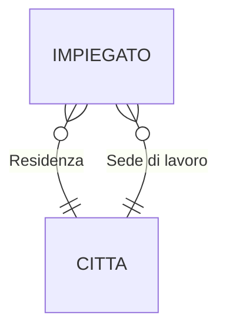

# 02 - DBMS e Modello Relazionale

> Fonte: [[DB/TEORIA/PDF/02 - DBMS e Modello Relazionale.pdf]] — Libro di testo: capitoli 1 e 2
> Slide tratte in parte da Atzeni, Ceri, Fraternali, Paraboschi, Torlone — *Basi di dati*, McGraw-Hill

**Argomenti**
1. DataBase Management System (DBMS), modelli dei dati, linguaggi e utenti
2. Relazioni e tabelle
3. Vincoli di integrità

Il **modello relazionale**, proposto negli anni '70, è ancora oggi lo standard più diffuso per la gestione dei dati. A differenza dei modelli gerarchico e a rete (stesso periodo, oggi in gran parte abbandonati), ha attraversato tutta l'evoluzione dei sistemi informativi — dai modelli a oggetti ai database NoSQL — restando il punto di riferimento.

> [!summary] Obiettivi dell'unità
> - **Schemi e linguaggi** — il linguaggio per definire lo schema (DDL) e per interrogare/modificare i dati (DML); SQL ne è l'implementazione più diffusa.
> - **Indipendenza** — l'architettura a tre livelli separa rappresentazione fisica, logica ed esterna, permettendo di cambiare l'implementazione senza toccare le applicazioni.
> - **Integrità** — chiavi, superchiavi e integrità referenziale garantiscono la coerenza dei dati.

---

# Parte 1 — DBMS, modelli dei dati, linguaggi e utenti

## 1.1 Informazioni e dati

- **Informazione**: notizia, nozione, elemento che consente di avere conoscenza più o meno esatta di fatti, situazioni, modi di essere.
- **Dato**: ciò che è immediatamente presente alla conoscenza, prima di ogni elaborazione; in informatica, *elementi di informazione costituiti da simboli che devono essere elaborati*.

Le informazioni vengono gestite in forme diverse (idee informali, linguaggio naturale, disegni e schemi, sistemi informatici) e su supporti diversi (mente umana, carta, dispositivi elettronici).

I DBMS relazionali trattano **dati**, non informazioni: i dati sono spesso il risultato di un'**organizzazione schematica** delle informazioni (es. anagrafe: Nome, Cognome, Codice fiscale, Data di nascita, Indirizzo).

## 1.2 Base di dati

Due accezioni:
1. Insieme organizzato di dati usati per supportare lo svolgimento di attività (azienda, ufficio, persona…).
2. Insieme di dati **gestito da un DBMS**, cioè da un software specializzato nella memorizzazione e interrogazione di dati.

## 1.3 Database Management System (DBMS)

Un **DBMS** è un sistema software che gestisce collezioni di dati:

| Caratteristica | Significato |
|---|---|
| **Grandi** | Dimensioni molto maggiori della memoria centrale (es. 500 GB di dati transazionali, 10 TB di dati decisionali, 500 TB di dati scientifici, 100 miliardi di post di un social) |
| **Persistenti** | Tempo di vita indipendente dalle singole esecuzioni dei programmi → devono stare su **memoria di massa** |
| **Condivise** | Risorsa integrata condivisa fra applicazioni → servono **meccanismi di autorizzazione** e **controllo della concorrenza** |

garantendo:

| Proprietà | Significato |
|---|---|
| **Privatezza** | Meccanismi di autorizzazione (es. A legge tutto e modifica X; B legge X e modifica Y) |
| **Affidabilità** | Resistenza a malfunzionamenti hardware e software; i dati vanno conservati a lungo termine |
| **Efficienza** | Uso ottimale di spazio (memoria principale e secondaria) e tempo (esecuzione e risposta) |
| **Efficacia** | Rendere produttive le attività degli utenti, con funzionalità articolate, potenti e flessibili |

Esempi: IBM DB2, Oracle, Microsoft SQL Server, MySQL, PostgreSQL e molti DBMS di nuova generazione (classifica aggiornata su <http://db-engines.com/en/ranking>).

## 1.4 Modelli dei dati

| Modelli **concettuali** | Modelli **logici** |
|---|---|
| Rappresentano i dati in modo **indipendente da ogni sistema** | Insieme di costrutti per **organizzare** i dati di interesse |
| Descrivono i concetti del mondo reale | Componente fondamentale: i **meccanismi di strutturazione** |
| Usati nelle fasi preliminari della progettazione | Es. il modello relazionale prevede il costruttore **relazione**, che definisce insiemi di record omogenei |
| Il più diffuso è il modello **Entity-Relationship (ER)** | |

**Esempio di schema ER**: due entità `Impiegato` e `Città` collegate da due associazioni, `Residenza` e `Sede di lavoro` (lo stesso impiegato può risiedere in una città e lavorare in un'altra).



### Storia dei modelli logici

| Modello | Periodo di adozione prevalente | Oggi |
|---|---|---|
| Gerarchico | anni '60 – anni '80 | abbandonato |
| A rete | anni '60 – anni '80 | abbandonato |
| **Relazionale** | anni '70 – oggi | ✅ in uso |
| Object-oriented | anni '90 – anni 2000 | |
| Object-relational | anni '90 – oggi | ✅ in uso |
| XML databases | anni 2000 – anni 2010 | |
| NoSQL (key-value, column, document, graph) | anni 2000 – oggi | ✅ in uso |

## 1.5 Schema e istanza

- **Schema**: la struttura **statica** della base di dati (es. l'intestazione della tabella).
- **Istanza**: i **valori attuali**, che possono cambiare nel tempo (il "corpo" della tabella).

| Insegnamento | Docente | Aula | Ora |
|---|---|---|---|
| Analisi matem. I | Luigi Neri | N1 | 8:00 |
| Basi di dati | Piero Rossi | N2 | 9:45 |
| Chimica | Nicola Mori | N1 | 9:45 |
| Fisica I | Mario Bruni | N1 | 11:45 |
| Fisica II | Mario Bruni | N3 | 9:45 |
| Sistemi inform. | Piero Rossi | N3 | 8:00 |

### Strutturazione dei dati e interrogazioni

**Corsi**

| Corso | Docente | Aula |
|---|---|---|
| Basi di dati | Rossi | DS3 |
| Sistemi | Neri | N3 |
| Reti | Bruni | N3 |
| Controlli | Bruni | G |

**Aule**

| Nome | Edificio | Piano |
|---|---|---|
| DS1 | OMI | Terra |
| N3 | OMI | Terra |
| G | Pincherle | Primo |

*"Dimmi edificio e piano delle aule dei corsi"* →

| Corso | Edificio | Piano |
|---|---|---|
| Sistemi | OMI | Terra |
| Reti | OMI | Terra |
| Controlli | Pincherle | Primo |

(Basi di dati non compare perché l'aula DS3 non è presente in `Aule`.)

> [!example] Esercizio — dallo schema logico al concettuale
> Dato lo schema relazionale con `PAZIENTI(Cod, Cognome, Nome)`, `RICOVERI(Paziente, Inizio, Fine, Reparto)`, `MEDICI(Matr, Cognome, Nome, Reparto)`, `REPARTI(Cod, Nome, Primario)`, quali informazioni descrive e qual è il suo modello concettuale?
>
> **Soluzione (ER)**: entità `Pazienti`, `Reparti`, `Medici`; associazioni `Ricovero` (Pazienti–Reparti), `Lavoro` (Medici–Reparti) e `Primario` (Medici–Reparti).
> ```mermaid
> erDiagram
>     PAZIENTI }o--o{ REPARTI : Ricovero
>     MEDICI }o--|| REPARTI : Lavoro
>     MEDICI |o--o| REPARTI : Primario
> ```

^es-concettuale

## 1.6 Architettura di un DBMS

Il progettista definisce lo **schema concettuale**, che viene tradotto nello **schema logico** (tabelle), implementato nel DBMS tramite strutture dati e algoritmi opportuni (**livello fisico**). Utenti e programmi interagiscono **solo con lo schema logico** (o con quello esterno).

### Architettura standard ANSI/SPARC a tre livelli

```
  utente   utente     utente   utente     utente
     \      /           |         \        /
  Schema esterno   Schema esterno   Schema esterno   ← viste
             \          |          /
                  Schema logico
                        |
              Schema fisico (interno)
                        |
                       BD
```

| Livello | Descrizione |
|---|---|
| **Schema esterno** | "Vista" parziale o derivata di una parte della base di dati, espressa nel modello logico |
| **Schema logico** | Descrizione dell'**intera** base di dati nel modello logico "principale" del DBMS |
| **Schema fisico** | Rappresentazione dello schema logico tramite **strutture fisiche di memorizzazione** |

## 1.7 Indipendenza dei dati

È conseguenza dell'articolazione in livelli: l'accesso avviene **solo tramite il livello esterno** (che può coincidere con quello logico).

| Indipendenza **fisica** | Indipendenza **logica** |
|---|---|
| I livelli logico ed esterno sono indipendenti da quello fisico | Il livello esterno è indipendente da quello logico |
| Una relazione si usa allo stesso modo qualunque sia la sua realizzazione fisica | Aggiunte o modifiche alle viste non richiedono modifiche al livello logico |
| La realizzazione fisica può cambiare **senza modificare i programmi** | Modifiche allo schema logico che lasciano inalterato lo schema esterno sono **trasparenti** |

## 1.8 Linguaggi per basi di dati

1. **Linguaggi testuali interattivi** (es. SQL): comandi digitati ed eseguiti direttamente.
2. **Comandi SQL immersi in un linguaggio ospite** (C, Python, Java…).
3. **Interfacce amichevoli**: accesso ai dati senza scrivere codice testuale.

| **DDL** — Data Definition Language | **DML** — Data Manipulation Language |
|---|---|
| Definizione e modifica degli **schemi** (logici, esterni, fisici) e altre operazioni generali | Interrogazione e aggiornamento (inserimento, cancellazione, modifica) delle **istanze** |
| `CREATE TABLE`, `ALTER TABLE`, `DROP TABLE` | `SELECT`, `INSERT`, `UPDATE`, `DELETE` |

### Esempio DML — *"Trovare i corsi tenuti in aule al piano terra"*

```sql
SELECT Corso, Aula, Piano
FROM Aule, Corsi
WHERE Nome = Aula
  AND Piano = 'Terra';
```

| Corso | Aula | Piano |
|---|---|---|
| Sistemi | N3 | Terra |
| Reti | N3 | Terra |

### Esempio DDL — creazione di una tabella

```sql
CREATE TABLE orario (
    insegnamento CHAR(20),
    docente      CHAR(20),
    aula         CHAR(4),
    ora          CHAR(5)
);
```

> [!question]- Vero o falso? (soluzioni nel callout)
> 1. L'indipendenza dei dati permette di scrivere programmi senza conoscere le strutture fisiche dei dati. → **Vero**
> 2. L'indipendenza dei dati permette di modificare le strutture fisiche senza modificare i programmi che accedono alla base di dati. → **Vero**
> 3. L'indipendenza dei dati permette di scrivere programmi conoscendo solo lo schema concettuale. → **Falso** (serve lo schema logico/esterno)
> 4. La distinzione fra DDL e DML corrisponde alla distinzione fra schema e istanza. → **Vero**
> 5. Le istruzioni DML permettono di modificare la base di dati ma non di interrogarla. → **Falso** (`SELECT` è DML)
> 6. Le istruzioni DDL permettono di specificare la struttura ma non di modificarla. → **Falso** (`ALTER TABLE`)
> 7. Non esistono linguaggi che includono sia istruzioni DDL sia DML. → **Falso** (SQL)

^vf-indipendenza

## 1.9 Ruoli nei DBMS

- Progettisti e sviluppatori di DBMS (livello fisico/software del DBMS)
- Progettisti e **amministratori della base di dati (DBA)**
- Analisti, progettisti e sviluppatori di applicazioni
- Utenti

### Database Administrator (DBA)
Persona o gruppo responsabile del **controllo centralizzato** e della gestione del sistema:
- **Gestione** del sistema e delle sue risorse
- **Prestazioni**: efficienza in spazio e tempo
- **Affidabilità**: conservazione a lungo termine
- **Autorizzazioni**: chi può leggere e modificare

Le funzioni del DBA includono la progettazione, anche se nei progetti complessi i ruoli possono essere distinti.

> [!tip] Concetti chiave — Parte 1
> DBMS, dato e informazione, base di dati, modello dei dati · ridondanza, incongruenza, DBMS vs file system · schema e istanza, modello concettuale e logico, schema fisico, indipendenza logica e fisica · DDL e DML · ruoli nei DBMS, DBA.

---

# Parte 2 — Il modello relazionale

## 2.1 Origini

- Proposto da **Codd nel 1970**, disponibile nei DBMS commerciali dal **1981**.
- Si basa sul concetto matematico di **relazione**, che ha una naturale rappresentazione tramite **tabelle**.

> [!warning] Tre accezioni del termine "relazione"
> 1. **Relazione matematica** — sottoinsieme di un prodotto cartesiano (teoria degli insiemi).
> 2. **Relazione nel modello relazionale** — il costrutto fondamentale: la **tabella**.
> 3. **Relationship** nel modello ER — legame tra entità (nel corso: **associazione**).

## 2.2 Relazione matematica

Dati $n$ insiemi (anche non distinti) $D_1, \dots, D_n$:

- **Prodotto cartesiano**: $D_1 \times \dots \times D_n = \{(d_1, \dots, d_n) \mid d_1 \in D_1, \dots, d_n \in D_n\}$
- **Relazione matematica** su $D_1, \dots, D_n$: un sottoinsieme $r \subseteq D_1 \times \dots \times D_n$. I $D_i$ sono i **domini** della relazione.

Essendo un **insieme**:
- non c'è ordinamento fra le n-uple;
- le n-uple (**tuple**) sono **distinte** (niente duplicati);
- ciascuna tupla è **ordinata**: l'$i$-esimo valore proviene dall'$i$-esimo dominio.

**Esempio**: $D_1 = \{a, b\}$, $D_2 = \{x, y, z\}$

$$D_1 \times D_2 = \{(a,x), (a,y), (a,z), (b,x), (b,y), (b,z)\}$$

Una possibile relazione: $r = \{(a,x), (a,z), (b,z)\} \subseteq D_1 \times D_2$ — scritta in colonna ricorda già una tabella.

### Struttura posizionale vs non posizionale

Nella relazione matematica ogni dominio ha un ruolo distinto **solo in base alla posizione**:

$\text{Partite} \subseteq \text{String} \times \text{String} \times \text{Int} \times \text{Int}$

| String | String | Int | Int |
|---|---|---|---|
| Juve | Lazio | 3 | 1 |
| Lazio | Milan | 2 | 0 |
| Juve | Roma | 0 | 2 |
| Roma | Milan | 0 | 1 |

Negli **RDBMS** (*Relational DBMS*) la struttura è **non posizionale**: a ogni dominio si associa un **nome univoco** nella tabella (**attributo**) che ne descrive il ruolo.

| Casa | Fuori | RetiCasa | RetiFuori |
|---|---|---|---|
| Juve | Lazio | 3 | 1 |
| Lazio | Milan | 2 | 0 |
| Juve | Roma | 0 | 2 |
| Roma | Milan | 0 | 1 |

## 2.3 Proprietà di tabelle e relazioni

- **Ordinamento irrilevante**: in una tabella che rappresenta una relazione, l'ordine di **righe** e **colonne** non conta.
- **Basato su valori**: i modelli gerarchico e reticolare usano **puntatori** espliciti fra record; nel relazionale anche i **riferimenti** fra dati di relazioni diverse sono rappresentati dai **valori stessi**.

**STUDENTI**

| Matricola | Cognome | Nome | Nascita |
|---|---|---|---|
| 6554 | Rossi | Mario | 1/3/2004 |
| 8765 | Neri | Paolo | 3/1/2006 |
| 9283 | Verdi | Luisa | 2/7/2005 |
| 3456 | Rossi | Maria | 1/2/2001 |

**ESAMI**

| Studente | Voto | Corso |
|---|---|---|
| 3456 | 30 | 04 |
| 3456 | 24 | 02 |
| 9283 | 28 | 01 |
| 6554 | 26 | 01 |

**CORSI**

| Codice | Titolo | Docente |
|---|---|---|
| 01 | Analisi | Mario |
| 02 | Chimica | Bruni |
| 04 | Chimica | Verdi |

- `ESAMI.Studente` si correla con `STUDENTI.Matricola`
- `ESAMI.Corso` si correla con `CORSI.Codice`

## 2.4 Schema di relazione e di base di dati

- **Schema di relazione** $R(A_1, A_2, \dots, A_n)$: un nome $R$ (la futura tabella) con un insieme di attributi $A_1, \dots, A_n$ (le colonne). Ogni attributo $A_i$ ha un **dominio** (tipo di dato).
- **Schema della base di dati**: insieme di schemi di relazione (le tabelle che compongono il database).

> [!example] Esercizio — Acquario civico
> - Ogni tipo di pesce ha un nome univoco (es. Piranha) e una famiglia (ciclidi, caracidi…).
> - Ogni vasca ha un nome univoco, una sala, un piano e una capienza in litri.
> - Si vuole tenere traccia della presenza e della numerosità dei pesci nelle vasche.
>
> **Schema logico**
> - `Pesce(NomeP, Famiglia)`
> - `Vasca(NomeV, Sala, Piano, Capienza)`
> - `Presenze(NomeP, NomeV, Quantità)`
>
> | NomeV | Sala | Piano | Capienza |
> |---|---|---|---|
> | SudAmerica | S3 | 1 | 2000 |
> | Messico | S3 | 2 | 800 |
>
> | NomeP | Famiglia |
> |---|---|
> | Scalare | Ciclidi |
> | Cardinale | Caracidi |
>
> | NomeP | NomeV | Quantità |
> |---|---|---|
> | Scalare | SudAmerica | 12 |
> | Scalare | Messico | 4 |
> | Cardinale | Messico | 70 |

^es-acquario

> [!example] Esercizio — Officine
> - Ogni automobile ha una targa univoca (es. AB123CD) e un modello.
> - Ogni officina ha un nome univoco, una città e una specializzazione.
> - Si vuole tenere traccia delle riparazioni, con data e costo.
>
> **Schema logico**
> - `Automobile(Targa, Modello)`
> - `Officina(NomeO, Città, Specializzazione)`
> - `Riparazione(Auto, NomeOfficina, Data, Costo)`
>
> | NomeO | Città | Specializzazione |
> |---|---|---|
> | AutoRapida | Cagliari | Meccanica |
> | CarrozzeriaSud | Quartu | Carrozzeria |
>
> | Targa | Modello |
> |---|---|
> | AB123CD | Panda |
> | EF456GH | Punto |
>
> | Auto | NomeOfficina | Data | Costo |
> |---|---|---|---|
> | AB123CD | AutoRapida | 10/01/26 | 150 |
> | AB123CD | CarrozzeriaSud | 03/02/26 | 400 |
> | EF456GH | AutoRapida | 22/01/26 | 90 |

^es-officine

## 2.5 Informazione incompleta e valore `NULL`

Come rappresentare un valore che non si conosce (es. la quantità di Scalari nella vasca Messico)?

**Non** conviene usare valori del dominio (0, stringa vuota, `"???"`…) perché:
- potrebbero non esistere valori "non utilizzati";
- valori "non utilizzati" potrebbero diventare significativi in futuro;
- nei programmi bisognerebbe ogni volta tener conto del loro significato speciale.

> [!info] `NULL`
> Tecnica rudimentale ma efficace che denota **l'assenza di un valore** del dominio. Non è un valore vero e proprio: rappresenta la mancanza di un valore per quell'attributo — un valore **inesistente** oppure **sconosciuto**.

---

# Parte 3 — Chiavi e vincoli di integrità

## 3.1 Identificazione delle tuple

È necessario che ogni tupla sia **identificabile univocamente**, indipendentemente dalle modifiche future ai dati. Ciò evita ambiguità e consente di **correlare** dati in relazioni diverse (il modello è basato su valori).

## 3.2 Superchiave e chiave

> [!definition] Superchiave
> Un insieme $K$ di attributi è **superchiave** per la relazione $r$ se $r$ non contiene due tuple distinte $t_1, t_2$ con $t_1[K] = t_2[K]$.

> [!definition] Chiave
> $K$ è **chiave** per $r$ se è una **superchiave minimale**, cioè non contiene propriamente un'altra superchiave.

**Interpretazione** (relazione `Vasca`):
- Se `NomeV` è chiave → non possono esistere due vasche con lo stesso nome.
- Se la chiave è `<NomeV, Piano>` → non possono esistere due vasche con lo stesso nome **sullo stesso piano** (ma su piani diversi sì).

> In generale: **più attributi** si mettono nella chiave, **meno restrittivo** è il vincolo di unicità.

**Esempio**

| Matricola | Cognome | Nome | Corso | Nascita |
|---|---|---|---|---|
| 27655 | Rossi | Mario | Ing Inf | 5/12/78 |
| 78763 | Rossi | Mario | Ing Inf | 3/11/76 |
| 65432 | Neri | Piero | Ing Mecc | 10/7/79 |
| 87654 | Neri | Mario | Ing Inf | 3/11/76 |
| 67653 | Rossi | Piero | Ing Mecc | 5/12/78 |

- `Matricola` è una chiave: è superchiave ed è formata da un solo attributo, quindi è minimale.
- `<Cognome, Nome, Nascita>` è un'altra chiave (in questa istanza): è superchiave e nessun suo sottoinsieme proprio lo è.

## 3.3 Teorema di esistenza delle chiavi

> [!theorem] Ogni relazione ha almeno una chiave.
> **Dimostrazione**
> 1. Una relazione è un insieme, quindi non può contenere tuple distinte ma uguali.
> 2. Dunque l'insieme $S$ di **tutti** i suoi attributi è una superchiave.
> 3. Ogni superchiave contiene una superchiave minimale (si tolgono attributi finché resta superchiave) → esiste almeno una chiave. $\blacksquare$

## 3.4 Chiave primaria

Possono esistere più chiavi per la stessa relazione (es. `Matricola` oppure `<Cognome, Nome, Nascita>`): se ne sceglie una come **chiave primaria**, usata poi per la tabella.

Si preferiscono chiavi:
- con il **minor numero di attributi**;
- **valide in ogni contesto** (non solo nell'istanza corrente).

**Notazione**: gli attributi della chiave primaria si **sottolineano**, es. Studenti(<u>Matricola</u>, Cognome, Nome, Corso, Nascita).

### Chiave artificiale (o surrogata)
Se la chiave naturale è troppo complessa (es. relazione *Esami medici*), si aggiunge un attributo `ID` con valori univoci (es. contatore incrementale).

| <u>ID</u> | Paziente | Esame | Esito | Medico | Data |
|---|---|---|---|---|---|
| 1 | p23 | TAC | POS | 03 | 3/1/16 |
| 2 | p5 | ECG | NEG | 01 | 2/1/16 |
| 3 | p5 | ECG | NEG | 01 | 1/1/16 |
| 4 | p7 | TAC | NEG | 04 | 2/1/16 |

### Chiavi e valori nulli
In presenza di `NULL` nei valori della chiave non è possibile:
- **identificare** le tuple;
- **realizzare i riferimenti** da altre relazioni.

> [!important] Gli attributi della chiave primaria **non possono** assumere valori nulli.

> [!question]- Vero o falso sulle chiavi (soluzioni)
> 1. Ogni attributo appartiene al massimo a una chiave. → **Falso** (es. `<A,B>` e `<A,C>` possono essere entrambe chiavi)
> 2. Possono esistere attributi che non appartengono a nessuna chiave. → **Vero**
> 3. Possono esistere attributi che non appartengono a nessuna superchiave. → **Falso** (l'insieme di tutti gli attributi è superchiave)
> 4. Una chiave può essere sottoinsieme di un'altra chiave. → **Falso** (violerebbe la minimalità)
> 5. Può esistere una chiave che coinvolge tutti gli attributi. → **Vero**
> 6. Possono esistere più chiavi di cui una coinvolge tutti gli attributi. → **Falso** (ogni altra chiave ne sarebbe un sottoinsieme proprio)
> 7. Una relazione può avere due chiavi primarie. → **Falso**
> 8. Una superchiave non minimale può essere sottoinsieme di una chiave primaria. → **Falso** (la chiave conterrebbe una superchiave propria)

^vf-chiavi

## 3.5 Esercizi sulle chiavi

> [!example]- Chiave di `ESAMI(Studente, Voto, Lode, Corso)`
> | Studente | Voto | Lode | Corso |
> |---|---|---|---|
> | 222222 | 30 | | 01 |
> | 111111 | 30 | e lode | 02 |
> | 333333 | 27 | | 03 |
> | 222222 | 24 | | 04 |
>
> - `Studente` da solo: impedirebbe a uno studente di sostenere più esami.
> - `<Studente, Voto>`: impedirebbe di prendere lo stesso voto in due esami diversi.
> - ✅ **`<Studente, Corso>`**: uno studente può sostenere più esami, ma non due volte lo stesso corso.

^es-chiave-esami

> [!example]- Chiave di `FATTURA` (numerazione che riparte ogni anno)
> | NumeroFattura | Anno | CodiceCliente | Importo |
> |---|---|---|---|
> | 1 | 2025 | C001 | 450 |
> | 2 | 2025 | C002 | 120 |
> | 1 | 2026 | C003 | 980 |
>
> `NumeroFattura` da solo non basta (la fattura 1 esiste sia nel 2025 sia nel 2026).
> ✅ Fattura(<u>Anno, NumeroFattura</u>, CodiceCliente, Importo)

^es-chiave-fattura

> [!example]- Chiave di `VOLO` (il codice identifica una tratta, riusata ogni giorno)
> | CodiceVolo | Data | Partenza | Arrivo | Posto | CFPasseggero |
> |---|---|---|---|---|---|
> | AZ204 | 12/03/26 | Roma | Milano | 14A | RSSMRA80A01H501U |
> | AZ204 | 12/03/26 | Roma | Milano | 14B | VRDLGU85B02F205X |
> | AZ204 | 13/03/26 | Roma | Milano | 14A | BNCNTN90C03D969W |
>
> - `CodiceVolo`: al massimo un passeggero per volo, e niente voli in giorni diversi → no.
> - `<CodiceVolo, Data>`: un solo passeggero per volo al giorno → no.
> - ✅ Esistono **due chiavi**:
>   - `<CodiceVolo, Data, Posto>` — un posto è occupato da un solo passeggero per volo;
>   - `<CodiceVolo, Data, CFPasseggero>` — un passeggero occupa un solo posto per volo.

^es-chiave-volo

> [!example]- Chiave di `DOCENZA` (corsi co-tenuti e riproposti negli anni)
> | CodiceCorso | CodiceDocente | AnnoAccademico | Ore |
> |---|---|---|---|
> | BD01 | D123 | 2024/25 | 40 |
> | BD01 | D456 | 2024/25 | 20 |
> | BD01 | D123 | 2025/26 | 60 |
>
> - `CodiceCorso`: BD01 ha due docenti nel 2024/25 → no.
> - `<CodiceCorso, CodiceDocente>`: D123 tiene BD01 in due anni diversi → no.
> - ✅ **`<CodiceCorso, CodiceDocente, AnnoAccademico>`**: identifica l'incarico di un docente su un corso in un anno.

^es-chiave-docenza

> [!example]- Chiave di `Acquisto`
> - `Cliente(codFisc, telefono, città)`
> - `Prodotto(Id, nome, marca, prezzo)`
> - `Acquisto(CF, IdProd, quantità, data)`
>
> Domande: e se compro più volte lo stesso prodotto? E se lo compro più volte **nello stesso giorno**?
>
> - `<CF, IdProd>` impedisce di riacquistare lo stesso prodotto.
> - `<CF, IdProd, data>` impedisce di riacquistarlo nello stesso giorno.
> - ✅ Si aggiunge una **chiave artificiale**: Acquisto(<u>codice</u>, CF, IdProd, quantità, data). La scelta migliore dipende comunque dalle specifiche.

^es-chiave-acquisto

## 3.6 Vincoli di integrità

Esistono istanze che **non rappresentano informazioni possibili** per l'applicazione:

| Studente | Voto | Lode | Corso |
|---|---|---|---|
| 111111 | **32** | | 01 |
| 111111 | 30 | e lode | 02 |
| 111111 | **18** | **e lode** | 03 |
| **333333** | 24 | | 04 |

| Matricola | Cognome | Nome |
|---|---|---|
| 111111 | Rossi | Mario |
| **787643** | Neri | Piero |
| **787643** | Bianchi | Luca |

Problemi: voto 32 fuori dominio; "18 e lode" contraddittorio; lo studente 333333 non esiste; la matricola 787643 è duplicata. ^es-db-scorretta

> [!definition] Vincolo di integrità
> Proprietà che deve essere soddisfatta dalle istanze che rappresentano informazioni corrette. È una **funzione booleana** (predicato) che associa a ogni istanza il valore *vero* o *falso*.

**Tipi di vincoli**
- **Intra-relazionali**
  - *Vincoli su valori* (o di dominio), es. `Stipendio > 0`
  - *Vincoli di tupla*, es. `DataFine >= DataInizio`
  - *Vincoli di chiave*
- **Inter-relazionali**: tra relazioni diverse (es. integrità referenziale)

**Osservazioni**
- Alcuni vincoli (non tutti) sono **supportati dal DBMS**, che ne impedisce la violazione. Per quelli non supportati la verifica è responsabilità del programmatore/utente.
- Le informazioni in relazioni diverse sono correlate tramite **valori comuni** (in particolare valori di chiave primaria): queste correlazioni devono essere **coerenti**.

### Esempio: infrazioni

**INFRAZIONI**

| Codice | Data | Vigile | Prov | Numero |
|---|---|---|---|---|
| 34321 | 1/2/95 | 3987 | MI | 39548K |
| 53524 | 4/3/95 | 3295 | TO | E39548 |
| 64521 | 5/4/96 | 3295 | PR | 839548 |
| 73321 | 5/2/98 | 9345 | PR | 839548 |

**VIGILI** (correlata tramite `Vigile`)

| Matricola | Cognome | Nome |
|---|---|---|
| 3987 | Rossi | Luca |
| 3295 | Neri | Piero |
| 9345 | Neri | Mario |
| 7543 | Mori | Gino |

**AUTO** (correlata tramite `<Prov, Numero>`)

| Prov | Numero | Cognome | Nome |
|---|---|---|---|
| MI | 39548K | Rossi | Mario |
| TO | E39548 | Rossi | Mario |
| PR | 839548 | Neri | Luca |

## 3.7 Vincolo di integrità referenziale (foreign key)

> [!definition] Integrità referenziale
> Un vincolo di integrità referenziale (**chiave esterna**, *foreign key*) fra gli attributi $X$ di una relazione $R_1$ e un'altra relazione $R_2$ impone che i valori su $X$ in $R_1$ compaiano come valori della **chiave primaria** di $R_2$.

```
   R1                                R2
┌────────────────────┐          ┌──────────────────┐
│ X (chiave esterna) │ ───────► │ chiave primaria  │
│ altri attributi... │          │ altri attributi..│
└────────────────────┘          └──────────────────┘
```

> [!example]- Esercizio — definire i vincoli referenziali
> **A)** `Studenti(Matricola, Cognome, Nome, DataNasc)`, `Esami(Studente, Voto, Corso)`, `Corsi(Codice, Titolo, Docente)`
> - `Esami.Corso` → `Corsi` (`Codice`)
> - `Esami.Studente` → `Studenti` (`Matricola`)
>
> **B)** `Cliente(codFisc, telefono, città)`, `Acquisto(CF, IdProd, quantità, data)`, `Prodotto(Id, nome, marca, prezzo)`
> - `Acquisto.CF` → `Cliente` (`codFisc`)
> - `Acquisto.IdProd` → `Prodotto` (`Id`)

^es-fk

> [!example]- Esercizio — chiavi e vincoli dello schema ospedaliero
> Relazioni: `PAZIENTI(Cod, Cognome, Nome)`, `RICOVERI(Paziente, Inizio, Fine, Reparto)`, `MEDICI(Matr, Cognome, Nome, Reparto)`, `REPARTI(Cod, Nome, Primario)`.
>
> **Chiavi primarie**
> - PAZIENTI: `Cod`
> - RICOVERI: `<Paziente, Inizio>` (si presume che un paziente non possa essere ricoverato due volte lo stesso giorno)
> - MEDICI: `Matr`
> - REPARTI: `Cod`
>
> **Vincoli referenziali**
> - `RICOVERI.Paziente` → `PAZIENTI.Cod`
> - `RICOVERI.Reparto` → `REPARTI.Cod`
> - `REPARTI.Primario` → `MEDICI.Matr`
> - `MEDICI.Reparto` → `REPARTI.Cod`

^es-ospedale

## 3.8 Azioni compensative

Quando un'operazione (es. cancellazione di una tupla riferita) causa una violazione dell'integrità referenziale:

- **Comportamento standard**: **rifiuto** dell'operazione (`RESTRICT` / `NO ACTION`).
- **Azioni compensative**:
  - **Eliminazione in cascata** (`CASCADE`)
  - **Introduzione di valori nulli** (`SET NULL`) o di valori di default (`SET DEFAULT`)

**Esempio** — `Impiegati(Matricola, Cognome, Progetto)` con `Progetto` → `Progetti(Codice, Inizio, Durata, Costo)`:

| Matricola | Cognome | Progetto |
|---|---|---|
| 34321 | Rossi | IDEA |
| 53524 | Neri | XYZ |
| 64521 | Verdi | NULL |
| 73032 | Bianchi | IDEA |

| Codice | Inizio | Durata | Costo |
|---|---|---|---|
| IDEA | 01/2000 | 36 | 200 |
| XYZ | 07/2001 | 24 | 120 |
| BOH | 09/2001 | 24 | 150 |

Se viene eliminato il progetto **XYZ**:
- con **cascata** → viene eliminata anche la tupla dell'impiegato 53524;
- con **valori nulli** → il `Progetto` dell'impiegato 53524 diventa `NULL`.

> [!example]- Esercizio — Prodotto / Riga d'ordine
> Un prodotto può essere ritirato dal catalogo, ma esistono righe d'ordine già evase e fatturate che lo referenziano; il codice prodotto può occasionalmente cambiare.
> - `PRODOTTO(CodiceProdotto, Nome, Prezzo)`
> - `RIGA_ORDINE(NumeroOrdine, CodiceProdotto, Quantità)` — chiave primaria `<NumeroOrdine, CodiceProdotto>`
>
> **Soluzione**
> - ❌ `SET NULL` non è applicabile: `CodiceProdotto` fa parte della chiave primaria di `RIGA_ORDINE`.
> - ❌ `CASCADE` in cancellazione è sbagliato: eliminerebbe righe d'ordine storiche da conservare per obblighi contabili e fiscali.
> - ✅ **`ON DELETE RESTRICT`**: si impedisce l'eliminazione fisica del prodotto finché esistono ordini collegati; il ritiro dal catalogo si gestisce con un attributo logico (una colonna aggiuntiva).
> - ✅ **`ON UPDATE CASCADE`**: la modifica del codice va propagata alle righe d'ordine.

^es-prodotto-riga

> [!example]- Esercizio — Utente / Recensione
> Un utente può cancellare il proprio account, ma le sue recensioni restano utili; il codice utente può cambiare in caso di fusione di account duplicati.
> - `UTENTE(CodiceUtente, Nome, Email)`
> - `RECENSIONE(CodiceRecensione, CodiceUtente, Testo, Voto)` — chiave primaria `CodiceRecensione`
>
> **Soluzione**
> - ❌ `CASCADE` in cancellazione cancellerebbe contenuti ancora utili.
> - Qui `CodiceUtente` **non** fa parte della chiave primaria → `SET NULL` è applicabile.
> - ✅ **`ON DELETE SET NULL`**: la recensione resta, l'autore diventa "utente eliminato".
> - ✅ **`ON UPDATE CASCADE`**: il collegamento si aggiorna automaticamente su tutte le recensioni.

^es-utente-recensione

> [!tip] Concetti chiave — Parti 2 e 3
> Modello basato sui valori · tre accezioni di "relazione" · tupla · struttura posizionale e non posizionale · proprietà di tabelle e relazioni · schema di relazione e di base di dati · `NULL` · vincoli di tupla · chiave, superchiave, chiave primaria, chiave artificiale · teorema di esistenza delle chiavi · integrità referenziale e azioni compensative.

---

# Tabella riassuntiva per gli esercizi

### Chiavi

| Concetto | Definizione | Come verificarlo negli esercizi |
|---|---|---|
| **Superchiave** | Insieme $K$ di attributi su cui due tuple distinte non coincidono mai | Chiediti se *nella realtà descritta* possono esistere due righe con gli stessi valori su $K$: se sì, non è superchiave |
| **Chiave** | Superchiave **minimale** | Togli un attributo alla volta: se ciò che resta è ancora superchiave, $K$ non era minimale |
| **Chiave primaria** | La chiave scelta per la tabella; **nessun `NULL`** | Fra le chiavi, preferisci quella con **meno attributi** e **valida in ogni contesto** |
| **Chiave artificiale** | Attributo `ID` aggiunto con valori univoci | Quando la chiave naturale è troppo complessa o non esiste (es. acquisti ripetuti lo stesso giorno) |
| **Chiave esterna (FK)** | I valori di $X$ in $R_1$ compaiono nella chiave primaria di $R_2$ | Un attributo che "nomina" un oggetto descritto in un'altra tabella; può essere `NULL` solo se non fa parte della PK |

> [!tip] Procedura per trovare la chiave
> 1. Parti dall'attributo che sembra identificare (es. `Studente`, `CodiceVolo`).
> 2. Cerca un controesempio realistico (stesso studente con più esami, stesso volo in giorni diversi…).
> 3. Aggiungi l'attributo che risolve il controesempio e ripeti.
> 4. Verifica la minimalità e controlla se esistono **altre chiavi** alternative (es. `VOLO`).
> 5. Ricorda: più attributi nella chiave → vincolo di unicità **meno restrittivo**.

### Tipi di vincolo

| Tipo | Ambito | Esempio |
|---|---|---|
| Di dominio | Singolo valore | `Voto` tra 18 e 30 · `Stipendio > 0` |
| Di tupla | Valori della stessa riga | `DataFine >= DataInizio` · niente lode se `Voto < 30` |
| Di chiave | Righe della stessa tabella | Matricola non duplicata |
| Referenziale | Tabelle diverse | `ESAMI.Studente` → `STUDENTI.Matricola` |

### Azioni compensative

| Azione | Effetto sulle tuple di $R_1$ che riferiscono la tupla cancellata/modificata | Quando sceglierla | Non applicabile se |
|---|---|---|---|
| **`RESTRICT` / `NO ACTION`** (default) | L'operazione viene **rifiutata** | Le tuple riferenti vanno conservate (dati storici, contabili) | — |
| **`CASCADE`** in cancellazione | Vengono **eliminate** anche le tuple riferenti | Le tuple riferenti non hanno senso senza quella riferita | Servono dati storici |
| **`CASCADE`** in modifica | Il nuovo valore viene **propagato** | Quasi sempre, quando un codice può cambiare | — |
| **`SET NULL`** | La FK diventa `NULL` | La tupla riferente ha senso anche senza riferimento (es. recensione di un utente eliminato) | La FK fa parte della **chiave primaria** |
| **`SET DEFAULT`** | La FK assume un valore di default | Esiste un valore di default sensato e presente in $R_2$ | Il default non esiste in $R_2$ |

### Indipendenza dei dati e linguaggi

| Concetto | Si modifica… | …senza toccare |
|---|---|---|
| Indipendenza **fisica** | lo schema fisico | schema logico, viste, programmi |
| Indipendenza **logica** | lo schema logico (lasciando inalterato quello esterno) | viste e programmi |
| **DDL** | schemi (`CREATE`, `ALTER`, `DROP`) | — |
| **DML** | istanze (`SELECT`, `INSERT`, `UPDATE`, `DELETE`) | — |

# Esercizi della lezione

| # | Esercizio | Argomento | Dove |
|---|---|---|---|
| 1 | Schema ospedaliero: dal logico al concettuale | Modelli logico/concettuale | [[#^es-concettuale]] |
| 2 | Vero o falso su indipendenza, DDL e DML | Architettura e linguaggi | [[#^vf-indipendenza]] |
| 3 | Acquario civico: schema logico e istanza | Schemi di relazione | [[#^es-acquario]] |
| 4 | Officine: schema logico e istanza | Schemi di relazione | [[#^es-officine]] |
| 5 | Vero o falso sulle chiavi | Chiavi e superchiavi | [[#^vf-chiavi]] |
| 6 | Chiave di `ESAMI` | Chiavi | [[#^es-chiave-esami]] |
| 7 | Chiave di `FATTURA` | Chiavi | [[#^es-chiave-fattura]] |
| 8 | Chiave di `VOLO` (due chiavi) | Chiavi | [[#^es-chiave-volo]] |
| 9 | Chiave di `DOCENZA` | Chiavi | [[#^es-chiave-docenza]] |
| 10 | Chiave di `Acquisto` | Chiave artificiale | [[#^es-chiave-acquisto]] |
| 11 | Base di dati "scorretta": individuare le violazioni | Vincoli di integrità | [[#^es-db-scorretta]] |
| 12 | Vincoli referenziali (schemi A e B) | Chiavi esterne | [[#^es-fk]] |
| 13 | Chiavi e vincoli dello schema ospedaliero | Chiavi e chiavi esterne | [[#^es-ospedale]] |
| 14 | Prodotto / Riga d'ordine | Azioni compensative | [[#^es-prodotto-riga]] |
| 15 | Utente / Recensione | Azioni compensative | [[#^es-utente-recensione]] |
