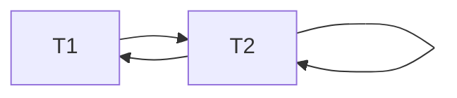

# 05 - Caratteristiche evolute dei DBMS relazionali

> Fonte: [[DB/TEORIA/PDF/05 - Caratteristiche evolute dei DBMS.pdf]]
> Slide tratte in parte da Atzeni, Ceri, Fraternali, Paraboschi, Torlone — *Basi di dati*, 4ª ed., McGraw-Hill 2014

**Argomenti**
1. Transazioni e proprietà ACID
2. Basi di dati attive e trigger
3. Autorizzazioni e controllo degli accessi

---

# Parte 1 — Transazioni e proprietà ACID

## 1.1 Definizione

> [!definition] Transazione
> Sequenza di operazioni da considerare **indivisibile** ("atomica"), **corretta** anche in presenza di **concorrenza** e con **effetti definitivi**.

**Esempio** — bonifico di 100 € dal conto di Tim al conto di Tom:
```
Inizio_transazione
    Sottrai 100 € dal saldo del conto di Tim
    Aggiungi 100 € al saldo del conto di Tom
Fine_transazione
```

## 1.2 Transazioni in SQL

Una transazione termina con:
- **`COMMIT`** — le operazioni specificate dall'inizio della transazione vengono **rese effettive** sulla base di dati;
- **`ROLLBACK`** — si **rinuncia** all'esecuzione delle operazioni specificate dall'inizio della transazione.

**Inizio**: al primo comando SQL dopo la connessione dell'utente, oppure dopo la conclusione della transazione precedente. Lo standard prevede anche `START TRANSACTION`, non obbligatorio (e quindi assente in molti sistemi).

```sql
START TRANSACTION;
UPDATE ContoCorrente
   SET Saldo = Saldo - 10
 WHERE NumeroConto = 123;
UPDATE ContoCorrente
   SET Saldo = Saldo + 10
 WHERE NumeroConto = 456;
COMMIT WORK;
```

### In PostgreSQL / pgAdmin
- **Autocommit attivo** (default in pgAdmin): ogni comando eseguito singolarmente apre e chiude la propria transazione.
- **Più comandi in un solo "Execute"** (separati da `;` nello stesso batch): PostgreSQL li tratta come **un'unica transazione implicita**, anche con autocommit attivo.
- **Autocommit disattivato** (o `BEGIN` esplicito): la transazione resta aperta finché non si esegue manualmente `COMMIT` o `ROLLBACK`.

### Da programma (es. Python con `psycopg2`)
- Autocommit **disattivato** di default — comportamento **opposto** a pgAdmin.
- Il primo `cursor.execute()` apre implicitamente una transazione (`BEGIN` invisibile); i comandi successivi ne fanno parte finché non si chiama `conn.commit()` o `conn.rollback()`.
- Se il programma termina o va in errore **prima del commit**, tutte le modifiche vengono **perse**.
- Per avere l'autocommit come in pgAdmin: `conn.autocommit = True`.

### Esempio — Anna compra 2 unità del prodotto P1 a 25 € l'una

| Passo | Caso 1: tutto va a buon fine | Caso 2: acquisto concorrente |
|---|---|---|
| `SELECT` Prodotto | Scorta P1: 10 ≥ 2? Sì | Scorta P1: 2 ≥ 2? Sì |
| `INSERT` Ordine | Anna: 2 × P1, totale 50 € | Anna: 2 × P1, totale 50 € |
| `UPDATE` Prodotto | Scorta P1: 10 − 2 = 8 | Scorta P1: 0 − 2 = **−2** ⚠️ (nel frattempo qualcuno ha comprato tutti i P1) |
| `INSERT` Pagamento | Addebito 50 € ad Anna | *non eseguito* |
| `UPDATE` Cliente | Punti fedeltà +50 | *non eseguito* |
| **Esito** | **COMMIT** — ordine pagato e da spedire | **ROLLBACK** — ordine annullato, scorta ripristinata |

^ex-anna

### Esempio — con e senza transazione
*Marco supera Basi di Dati (9 CFU) con voto 28.* Passi: verifica iscrizione → `INSERT` esame (voto 28) → `UPDATE` CFU studente → `UPDATE` media → `DELETE` iscrizione all'appello. Guasto dopo il secondo passo:

| | Con transazione | Senza transazione |
|---|---|---|
| Esito | **ROLLBACK**: voto annullato, carriera **coerente** | Stato **incoerente**: voto registrato senza CFU, media errata, studente ancora iscritto |

^ex-marco

## 1.3 Proprietà ACID

| Lettera | Proprietà | In breve |
|---|---|---|
| **A** | **Atomicità** | Tutto o niente |
| **C** | **Consistenza** | I vincoli sono rispettati alla fine |
| **I** | **Isolamento** | Le transazioni concorrenti non interferiscono |
| **D** | **Durability** (persistenza) | Gli effetti del commit sono permanenti |

### Atomicità
La sequenza di operazioni viene eseguita **per intero o per niente**. Se la transazione non si completa correttamente (guasto, violazione di vincoli, richiesta dell'utente), il DBMS **annulla tutta la transazione** e riporta il DB allo stato iniziale.

> [!example] Bonifico di 100 € da A (600) a B (400)
> - **Caso 1 — tutto ok**: preleva da A (500/400) → versa su B (500/500) → **COMMIT**: tutto salvato.
> - **Caso 2 — guasto a metà**: preleva da A (500/400) → guasto, versamento non eseguito → **ROLLBACK**: A = 600, B = 400, prelievo annullato.

^ex-atomicita

### Consistenza
Al termine della transazione i **vincoli di integrità devono essere soddisfatti**. Durante l'esecuzione possono esserci violazioni temporanee, ma se restano alla fine la transazione va annullata per intero.

> [!example] Vincolo `Impiegato.dip → Dipartimento.codice`
> Stato iniziale: dipartimenti D1, D2; Rossi in D1.
> - **Caso 1**: `INSERT` Bianchi in D3 (D3 non esiste: vincolo violato temporaneamente) → `INSERT` dipartimento D3 (riferimento ok) → **COMMIT**.
> - **Caso 2**: `INSERT` Bianchi in D3 → fine senza inserire D3 (FK violata) → **ROLLBACK**: si torna a D1, D2 e Rossi in D1.

^ex-consistenza

### Isolamento
L'effetto di transazioni **concorrenti** deve essere coerente (nel caso migliore, **equivalente a un'esecuzione seriale**). Es. se due assegni sullo stesso conto vengono incassati contemporaneamente, non bisogna trascurarne uno.

Il livello più forte, **`SERIALIZABLE`**, garantisce un risultato equivalente a **una qualche esecuzione seriale**; non tutti i livelli di isolamento lo garantiscono.

> [!example] Prenotazione del posto 07F su un volo
> Tim e Tom eseguono ciascuno una transazione *«leggi lo stato del posto → se è libero, prenotalo»*, insieme ad altre operazioni (Tom acquista il bagaglio, Tim sceglie il pasto).
> - **Senza isolamento**: le operazioni delle due transazioni si **intrecciano** liberamente: Tim legge "07F libero" → Tom legge "07F libero" → Tim prenota 07F → Tom prenota 07F → **posto assegnato due volte**. Entrambe le transazioni sono state eseguite **per intero**, quindi l'atomicità è rispettata: il problema è che ognuna ha deciso sulla base di un dato che l'altra stava per cambiare.
> - **Con isolamento** (le transazioni procedono comunque in parallelo): il DBMS **non permette** che Tom legga lo stato di 07F mentre la transazione di Tim, che lo ha letto per prenotarlo, è ancora in corso. La lettura di Tom viene **ritardata** finché Tim non ha prenotato, quindi Tom vede "07F occupato" e ripiega su 07E → **07F a Tim, 07E a Tom**. Le operazioni che non riguardano 07F (bagaglio, pasto) continuano in parallelo.
>
> Il risultato è lo stesso che si otterrebbe eseguendo **prima tutta la transazione di Tim e poi tutta quella di Tom** (esecuzione seriale).

^ex-volo

> [!example] Vendita prodotti (scorta iniziale 10)
> - **Senza isolamento**: T1 (vende 8) legge 10 → T2 (vende 7) legge 10 → entrambi controllano OK → T1 scrive 10 − 8 = 2 → T2 scrive 2 − 7 = **−5**: vendute 15 unità su 10 disponibili.
> - **Con isolamento**: T1 legge 10, controlla, scrive 2 → T2 legge 2 → controlla 7 > 2 → **vendita di T2 rifiutata**.

^ex-vendita

### Durability (persistenza)
La conclusione positiva di una transazione (**commit**) è un impegno a **mantenere traccia del risultato in modo definitivo**, anche in presenza di guasti. Il meccanismo chiave è il **log** su memoria stabile.

> [!example] Bonifico di 100 € da Tim (500) a Tom (200)
> - **Guasto dopo il commit**: le scritture `Tim −100`, `Tom +100` e il record `COMMIT` sono nel **log** (memoria stabile, sopravvive al guasto). Al riavvio il DBMS rilegge il log → **Tim 400, Tom 300: salvato**.
> - **Guasto prima del commit**: nel log c'è `Tim −100`, ma non c'è certezza sul secondo `UPDATE` e **manca il `COMMIT`**. Al riavvio → **Tim 500, Tom 200: annullato**.

^ex-durability

## 1.4 Supporto delle proprietà ACID

I DBMS relazionali garantiscono ACID (in modo variabile e configurabile), ma ciò **ha un impatto negativo sull'efficienza**.

| **NoSQL** | **NewSQL** |
|---|---|
| DBMS non relazionali: in generale supportano **versioni deboli** di ACID per essere più efficienti | DBMS relazionali di nuova generazione: cercano di **conciliare ACID ed efficienza** |

---

# Parte 2 — Basi di dati attive e trigger

## 2.1 Paradigma ECA

Una **base di dati attiva** contiene **regole attive** (**trigger**) che rispondono automaticamente a determinati eventi secondo il paradigma **Evento – Condizione – Azione**:

1. **Evento** — di solito una modifica dello stato del DB (`INSERT`, `DELETE`, `UPDATE`); quando accade, il trigger è **attivato**.
2. **Condizione** — un predicato che stabilisce se l'azione deve essere eseguita.
3. **Azione** — una sequenza di comandi SQL.

Questo modello consente **computazioni reattive** (non è l'unico tipo di regola: anche le azioni compensative dei vincoli di integrità lo sono).

> **Vantaggio** rispetto a implementare le regole esternamente: la **logica dei dati** è separata dalla **logica delle applicazioni**.

## 2.2 Sintassi

Ogni trigger è caratterizzato da: **nome**, **target** (tabella controllata), **modalità** (`BEFORE`/`AFTER`), **evento** (`INSERT`/`DELETE`/`UPDATE`), **granularità** (statement-level / row-level), **azione**.

I DBMS usano sintassi diverse; nel corso si usa una pseudo-sintassi semplificata:

```sql
CREATE TRIGGER NomeTrigger
  { BEFORE | AFTER } { INSERT | DELETE | UPDATE [OF Colonna] }
  ON TabellaTarget
  [REFERENCING
     { [OLD TABLE [AS] VarTabellaOld] [NEW TABLE [AS] VarTabellaNew] } |
     { [OLD [ROW] [AS] VarTuplaOld]   [NEW [ROW] [AS] VarTuplaNew] } ]
  [FOR EACH { ROW | STATEMENT }]
  [WHEN Condizione]
  StatementProceduraleSQL
```

## 2.3 Granularità

| **Statement-level** (default) | **Row-level** |
|---|---|
| Considerato ed eventualmente eseguito **una volta per comando**, indipendentemente dal numero di tuple modificate | Considerato ed eventualmente eseguito **una volta per ogni riga modificata** |
| In linea con la natura *set-oriented* di SQL | |
| Variabili: `old_table` (stato precedente della porzione di tabella interessata), `new_table` (stato prodotto dalla modifica) | Variabili: `old` (tupla prima della modifica), `new` (tupla dopo la modifica) |

## 2.4 Modalità

### `BEFORE`
Il trigger è considerato ed eventualmente eseguito **prima** della modifica.
- Non può modificare lo stato del DB: può al più **condizionare i valori `new`**.
- Usato per **verificare** una modifica prima che avvenga e "**modificare la modifica**".

**Esempio — "Conditioner"** (agisce prima dell'update e della verifica di integrità): ^tr-conditioner

```sql
CREATE TRIGGER LimitaAumenti
BEFORE UPDATE OF Salario ON Impiegato
FOR EACH ROW
WHEN (New.Salario > Old.Salario * 1.2)
  SET New.Salario = Old.Salario * 1.2
```
✅ Il controllo avviene prima, evitando scritture inutili. ⚠️ Se però l'operazione viene poi rifiutata, l'azione del trigger è stata comunque eseguita.

### `AFTER`
Il trigger è considerato ed eseguito **dopo** l'evento. È la modalità **più comune**.

**Esempio — "Re-installer"** (agisce dopo l'update): ^tr-reinstaller

```sql
CREATE TRIGGER LimitaAumenti
AFTER UPDATE OF Salario ON Impiegato
FOR EACH ROW
WHEN (New.Salario > Old.Salario * 1.2)
  UPDATE Impiegato
     SET Salario = Old.Salario * 1.2
   WHERE ImpNum = New.ImpNum
```
✅ Se l'operazione fallisce, il trigger non viene valutato. ⚠️ Se va a buon fine, occorre **sovrascrivere** quanto già scritto.

### Esempi di granularità

**Row-level** — registra ogni prelievo:
```sql
CREATE TRIGGER AccountMonitor
AFTER UPDATE ON Account
FOR EACH ROW
WHEN New.Totale < Old.Totale
  INSERT INTO Prelievi
  VALUES (New.NumeroConto, Old.Totale - New.Totale, now())
```

**Statement-level** — archivia le fatture cancellate:
```sql
CREATE TRIGGER ArchiviaFattureCancellate
AFTER DELETE ON Fattura
  INSERT INTO FattureCancellate
  (SELECT * FROM old_table)
```

## 2.5 Esempi guidati

Tabelle: `Prodotti(CodProdotto, Nome, Prezzo, Scorta)` e `Vendite(CodVendita, CodProdotto, Quantita, DataVendita)`. Ogni vendita registra la quantità venduta di un prodotto; `Scorta` è la giacenza.

**AFTER · ROW-LEVEL** — a ogni inserimento in `Vendite`, decrementa la scorta: ^tr-aggiornascorta

```sql
CREATE TRIGGER AggiornaScorta
AFTER INSERT ON Vendite
FOR EACH ROW
  UPDATE Prodotti
     SET Scorta = Scorta - New.Quantita
   WHERE CodProdotto = New.CodProdotto
```

**BEFORE · ROW-LEVEL** — annulla l'inserimento se la quantità supera la scorta: ^tr-verificascorta

```sql
CREATE TRIGGER VerificaScorta
BEFORE INSERT ON Vendite
FOR EACH ROW
WHEN (New.Quantita > (SELECT Scorta FROM Prodotti
                      WHERE CodProdotto = New.CodProdotto))
  ROLLBACK
```

**AFTER · STATEMENT-LEVEL** — dopo ogni modifica a `Prodotti` (anche su più righe), annulla se una scorta è negativa: ^tr-verificascorte

```sql
CREATE TRIGGER VerificaScorte
AFTER UPDATE ON Prodotti
WHEN EXISTS (SELECT * FROM new_table WHERE Scorta < 0)
  ROLLBACK
```

**BEFORE · STATEMENT-LEVEL** — blocca un inserimento massivo se la quantità totale supera 1000 (controllo sull'intero lotto, non sulla singola riga): ^tr-limitaordine

```sql
CREATE TRIGGER LimitaOrdineTotale
BEFORE INSERT ON Vendite
WHEN (SELECT sum(Quantita) FROM new_table) > 1000
  ROLLBACK
```

### Confronti

> [!tip] BEFORE vs AFTER sullo stesso evento (`INSERT` in `Vendite`)
> - **`VerificaScorta` (BEFORE)** condiziona i valori proposti e può **impedire** la scrittura: la vendita non viene mai registrata se la scorta non basta.
> - **`AggiornaScorta` (AFTER)** agisce sui dati **già scritti**: la scorta si aggiorna subito dopo la registrazione.
>
> BEFORE **impedisce o corregge** prima che la modifica avvenga; AFTER **reagisce** a una modifica già avvenuta.

> [!tip] Trigger in cascata (*cascading triggers*)
> `AggiornaScorta` (AFTER row-level su `Vendite`) esegue un `UPDATE` su `Prodotti`, che è a sua volta un evento: attiva `VerificaScorte` (AFTER statement-level su `Prodotti`), pur non essendo questo direttamente collegato all'insert in `Vendite`.

| Strategia | Come agisce | Pro / contro |
|---|---|---|
| **BEFORE** (`VerificaScorta`) | Blocca l'insert se eccede la scorta | Efficiente, ma una transazione concorrente può **scavalcare il controllo** (cfr. esempio di Anna) |
| **AFTER** (`AggiornaScorta` + `VerificaScorte`) | Scrive sempre; poi verifica e fa rollback se serve | **Robusto** sotto concorrenza (controlla lo stato realmente scritto), ma scrive (ed eventualmente disfa) anche casi evitabili |

^tr-strategie

> La soluzione più solida **le combina entrambe**.

## 2.6 Esecuzione dei trigger

### Trigger in conflitto
Con più trigger associati allo stesso evento:
1. prima i trigger **`BEFORE`**;
2. poi la **modifica**;
3. infine i trigger **`AFTER`**.

Fra trigger della stessa categoria l'ordine dipende dal DBMS: per **timestamp di creazione** (alcuni privilegiano i più vecchi) oppure per **ordine alfabetico**.

### Terminazione
L'azione di un trigger può attivare altri trigger, generando potenzialmente **cicli infiniti**. Esiti possibili:
- l'esecuzione termina correttamente;
- termina **in errore** al raggiungimento di una certa profondità di ciclo;
- viene fatto un **rollback** allo stato precedente l'attivazione dei trigger.

### Grafo di triggering
- Un **nodo** per ogni trigger.
- Un **arco** $t_i \to t_j$ se l'azione di $t_i$ può attivare $t_j$.

> [!important]
> - Grafo **aciclico** → l'esecuzione **termina sempre**.
> - Grafo **con cicli** → **possibili** problemi di terminazione.

**Esempio con due trigger** ^tr-t1t2

```sql
-- T1: garantisce un vincolo di tupla
CREATE TRIGGER AggiornaContributi
AFTER UPDATE OF Stipendio ON Impiegato
  UPDATE Impiegato
     SET Contributi = Stipendio * 0.8
   WHERE Matr IN (SELECT Matr FROM new_table)

-- T2
CREATE TRIGGER ControllaSogliaBudget
AFTER UPDATE ON Impiegato
WHEN 50000 < (SELECT (New.Stipendio + New.Contributi) FROM Impiegato)
  UPDATE Impiegato
     SET Stipendio = 0.9 * Stipendio
```



Ci sono **due cicli**, ma il sistema **termina sempre**: ogni esecuzione di T2 riduce lo stipendio, finché la condizione diventa falsa. Sarebbe **non terminante** se in T2 il fattore moltiplicativo fosse **maggiore di 1**.

**Esempio di non terminazione** ^tr-t3

```sql
CREATE TRIGGER ControllaStipendio   -- T3
AFTER UPDATE ON Impiegato
WHEN New.Stipendio < 50000
  UPDATE Impiegato
     SET Stipendio = 0.9 * Stipendio
```
Ogni esecuzione riduce lo stipendio del 10%, che resta **sempre sotto 50000**: la condizione resta vera per sempre → **T3 non termina mai** (auto-anello nel grafo).

## 2.7 Uso dei trigger per il controllo di coerenza

Vincoli che **nessun vincolo dichiarativo** (PK, FK, `CHECK`) può esprimere.

> [!example] Relazione asimmetrica — `Confronto`
> - `Superficie(CodSuperficie PK, Nome)`
> - `Tennista(CodTennista PK, Nome)`
> - `Confronto(CodSuperficie, Migliore, Peggiore)` — tutti PK; `Migliore` e `Peggiore` FK verso `Tennista`
>
> Lo schema non impedisce:
>
> | Superficie | Migliore | Peggiore |
> |---|---|---|
> | Erba | Sinner | Alcaraz |
> | Erba | Alcaraz | Sinner |
>
> Un `CHECK` non può confrontare una riga con le altre della stessa tabella. **Trigger**: dopo l'inserimento di "A migliore di B su S", se esiste già "B migliore di A su S", elimina la tupla appena inserita.

^tr-confronto

> [!example] Il direttore deve afferire al proprio dipartimento
> - `Impiegato(ImpNum PK, Nome, CodDip FK)`
> - `Dipartimento(CodDip PK, Nome, Direttore FK)`
>
> | CodDip | Nome | Direttore |
> |---|---|---|
> | D1 | Vendite | I7 |
>
> | ImpNum | Nome | CodDip |
> |---|---|---|
> | I7 | Marco Neri | D3 |
>
> I7 dirige D1 ma afferisce a D3: nessuna FK lo impedisce. **Trigger**: dopo inserimento/modifica di "il Dip. X ha come direttore Y", verifica che Y afferisca a X e, se no, correggi l'incoerenza.

^tr-direttore

> [!example] Dato derivato — `Docenza`
> - `Corso(CodCorso PK, Nome, CodProf FK)`
> - `Frequenza(Studente, Corso)` — PK, FK
> - `Docenza(Matricola, CodProf)` — PK, FK
>
> `Docenza` deve contenere **esattamente** le coppie derivabili da `Frequenza` e `Corso`. Con `Corso(C1, Prof1)` e il nuovo `Frequenza(Stud1, C1)`, la coppia `(Stud1, Prof1)` manca in `Docenza`.
>
> ```sql
> CREATE TRIGGER AggiornaDocenza
> AFTER INSERT ON Frequenza
> WHEN (NOT EXISTS (
>         SELECT * FROM Docenza
>          WHERE Matricola = New.Studente
>            AND CodProf = (SELECT CodProf FROM Corso
>                            WHERE CodCorso = New.Corso)))
>   INSERT INTO Docenza
>   VALUES (New.Studente,
>           (SELECT CodProf FROM Corso WHERE CodCorso = New.Corso))
> ```
> Il trigger aggiunge la tupla `Docenza(Stud1, Prof1)`.

^tr-docenza

## 2.8 Discussione

> *"A cosa servono i trigger? Posso fare tutto da applicazione!"*

I trigger implementano la **logica dei dati**, non quella delle applicazioni: caratteristiche **invarianti** che devono valere **qualunque applicazione** acceda ai dati.

**Vantaggi**
- **Non possono essere aggirati**: anche script, altre applicazioni o accessi diretti al DB rispettano il vincolo.
- Esprimono vincoli che lo schema SQL dichiarativo non può catturare (es. `Confronto`, `Impiegato/Dipartimento`, `Docenza`).
- Mantengono automaticamente sincronizzati i **dati derivati**.
- Utili per compiti trasversali come **audit e logging** (chi e quando modifica i dati).

**Limiti e problemi**
- Logica **"nascosta"**: leggendo solo il codice applicativo non si vede cosa accade ai dati → più difficile capire e fare debug.
- Effetti **a cascata** difficili da prevedere, specie con più trigger in conflitto.
- Rischio di **non terminazione** (cicli nel grafo di triggering).
- Un trigger `BEFORE` che controlla e poi scrive può essere **scavalcato da una transazione concorrente** se l'isolamento non basta.
- **Overhead** su operazioni massive (bulk insert): ogni scrittura può scatenare query aggiuntive.
- Sintassi molto variabile fra DBMS → codice **poco portabile**.
- Difficili da **testare e mantenere**.

> [!summary] In sintesi
> I trigger sono utili per **invarianti semplici e locali ai dati**: vanno usati con misura, non come sostituto della logica applicativa.

---

# Parte 3 — Autorizzazioni e controllo degli accessi

## 3.1 Controllo dell'accesso

In SQL si può specificare **chi** (utente) e **come** (lettura, scrittura, …) può usare la base di dati o parte di essa.

- Oggetto dei privilegi sono di solito le **tabelle**, ma anche singoli **attributi**, **viste** o **domini**.
- Un utente predefinito (**amministratore** del DB) ha tutti i privilegi.
- Il **creatore** di una risorsa ha tutti i privilegi su di essa.

## 3.2 Privilegi

Un privilegio è caratterizzato da:
- la **risorsa** cui si riferisce;
- l'utente che **concede** il privilegio;
- l'utente che lo **riceve**;
- l'**azione** permessa;
- la **trasmissibilità** del privilegio.

| Privilegio | Permette di |
|---|---|
| `INSERT` | Inserire nuovi oggetti (ennuple) |
| `UPDATE` | Modificare il contenuto |
| `DELETE` | Eliminare oggetti |
| `SELECT` | Leggere la risorsa |
| `REFERENCES` | Definire vincoli di integrità referenziale verso la risorsa (può limitare le modifiche del proprietario, es. con `NO ACTION`) |
| `ALTER` | Modificare lo schema |

## 3.3 `GRANT` e `REVOKE`

**Concessione**
```sql
GRANT <Privilegi | ALL PRIVILEGES>
   ON Risorsa
   TO Utenti [WITH GRANT OPTION];
```
`WITH GRANT OPTION` permette di **trasmettere** il privilegio ad altri utenti.

```sql
GRANT SELECT ON Department TO Stefano WITH GRANT OPTION;
```

**Revoca**
```sql
REVOKE Privilegi ON Risorsa FROM Utenti [RESTRICT | CASCADE];
```
- `RESTRICT`: se gli utenti hanno concesso il privilegio ad altri, **blocca** la revoca.
- `CASCADE`: se gli utenti hanno concesso il privilegio ad altri, **propaga** la revoca in cascata.

**Esempi** (`PUBLIC` = tutti gli utenti)
```sql
GRANT SELECT ON films TO PUBLIC;
REVOKE INSERT ON films FROM PUBLIC;
GRANT SELECT, UPDATE ON mytable TO bill;
GRANT SELECT(title), UPDATE(title) ON films TO alice;   -- privilegi su singola colonna
GRANT ALL PRIVILEGES ON films TO bill;
```

## 3.4 Segretezza e visibilità

**Segretezza** — la gestione delle autorizzazioni deve "nascondere" gli elementi inaccessibili **senza destare sospetti**: se `Impiegati` non esiste e `ImpiegatiSegreti` esiste ma l'utente non è autorizzato, l'utente deve ricevere **lo stesso messaggio** in entrambi i casi.

**Visibilità** — per far vedere a un utente **solo alcune tuple** di una relazione si usa una **vista**:
1. si definisce la vista con una condizione di selezione;
2. si attribuiscono le autorizzazioni sulla **vista** anziché sulla relazione di base.

## 3.5 Ruoli e utenti

Un **ruolo** raccoglie privilegi (anche articolati), che vengono poi concessi agli utenti attribuendo loro il ruolo.

```sql
CREATE USER jim WITH PASSWORD 'jw8s0F4';   -- nuovo utente
CREATE ROLE amministratori;                -- nuovo ruolo

GRANT SELECT ON films TO amministratori;   -- privilegi al ruolo
GRANT amministratori TO joe;               -- membership del ruolo a "joe"
```

---

> [!tip] Concetti chiave
> Transazione, `COMMIT`/`ROLLBACK`, autocommit · proprietà ACID (atomicità, consistenza, isolamento, durability) e log · NoSQL vs NewSQL · paradigma ECA, trigger `BEFORE`/`AFTER`, row-level/statement-level, `old`/`new`, `old_table`/`new_table` · trigger in cascata e in conflitto, grafo di triggering e terminazione · privilegi, `GRANT`/`REVOKE`, `WITH GRANT OPTION`, `RESTRICT`/`CASCADE`, viste per la visibilità, ruoli.

---

# Tabella riassuntiva per gli esercizi

### Proprietà ACID

| Proprietà | Cosa garantisce | Violazione tipica | Meccanismo |
|---|---|---|---|
| **Atomicità** | Tutto o niente | Bonifico interrotto a metà | `ROLLBACK` (annullamento tramite log) |
| **Consistenza** | Vincoli rispettati **alla fine** della transazione | FK ancora violata al termine | Verifica dei vincoli, `ROLLBACK` |
| **Isolamento** | Esecuzione concorrente equivalente a una seriale | Posto assegnato due volte, scorta negativa | Controllo della concorrenza, livello `SERIALIZABLE` |
| **Durability** | Effetti permanenti dopo il `COMMIT` | Perdita dei dati dopo un guasto | Log su memoria stabile, recovery al riavvio |

### Scegliere il trigger

| Richiesta dell'esercizio | Modalità | Granularità | Azione tipica |
|---|---|---|---|
| "Prima di inserire/modificare, **impedisci** se…" (controllo sulla riga) | `BEFORE` | `ROW` | `ROLLBACK` |
| "**Limita / correggi** il valore inserito" | `BEFORE` | `ROW` | `SET New.Attr = …` |
| "Dopo ogni inserimento **aggiorna** un'altra tabella" (dato derivato) | `AFTER` | `ROW` | `UPDATE` / `INSERT` usando `New` |
| "**Registra / archivia**" le modifiche (log, audit) | `AFTER` | `ROW` (una riga per modifica) o `STATEMENT` (con `old_table`/`new_table`) | `INSERT INTO …` |
| Controllo **sull'intero comando** ("anche su più righe", "totale del lotto") | `AFTER` o `BEFORE` | `STATEMENT` | `WHEN EXISTS (SELECT … FROM new_table …) ROLLBACK` |
| Vincolo **fra righe** della stessa tabella o **fra tabelle** non esprimibile con PK/FK/`CHECK` | `AFTER` | `ROW` | Verifica con sottoquery, poi `DELETE` / correzione |

### Variabili disponibili

| Evento | Row-level | Statement-level |
|---|---|---|
| `INSERT` | `New` | `new_table` |
| `DELETE` | `Old` | `old_table` |
| `UPDATE` | `Old`, `New` | `old_table`, `new_table` |

### Terminazione

| Passo | Cosa fare |
|---|---|
| 1 | Un nodo per trigger |
| 2 | Arco $t_i \to t_j$ se l'**azione** di $t_i$ (tipo di comando + tabella, ed eventualmente colonna) coincide con l'**evento** di $t_j$ |
| 3 | Grafo **aciclico** → termina sempre |
| 4 | Grafo **ciclico** → controlla se la condizione prima o poi diventa falsa: T2 riduce lo stipendio finché scende sotto la soglia → **termina**; T3 riduce uno stipendio già sotto la soglia, che resta sotto → **non termina** |

### Autorizzazioni

| Comando | Sintassi | Note |
|---|---|---|
| Concessione | `GRANT priv ON risorsa TO utenti [WITH GRANT OPTION]` | `WITH GRANT OPTION` → il privilegio è trasmissibile |
| Revoca | `REVOKE priv ON risorsa FROM utenti [RESTRICT \| CASCADE]` | `RESTRICT` blocca se il privilegio è stato trasmesso, `CASCADE` propaga |
| Solo alcune colonne | `GRANT SELECT(col), UPDATE(col) ON t TO u` | — |
| Solo alcune righe | Vista con `WHERE` + `GRANT` sulla vista | — |
| Ruoli | `CREATE ROLE r` · `GRANT priv ON t TO r` · `GRANT r TO u` | — |

# Esercizi della lezione

**Transazioni e ACID**

| # | Esempio | Dove |
|---|---|---|
| 1 | Anna compra 2 unità di P1 (con e senza acquisto concorrente) | [[#^ex-anna]] |
| 2 | Marco supera Basi di Dati: con e senza transazione | [[#^ex-marco]] |
| 3 | Atomicità: bonifico da A a B | [[#^ex-atomicita]] |
| 4 | Consistenza: impiegati e dipartimenti | [[#^ex-consistenza]] |
| 5 | Isolamento: prenotazione del posto 07F | [[#^ex-volo]] |
| 6 | Isolamento: vendita prodotti | [[#^ex-vendita]] |
| 7 | Durability: guasto prima e dopo il commit | [[#^ex-durability]] |

**Trigger**

| # | Esercizio | Dove |
|---|---|---|
| 8 | `LimitaAumenti` in modalità BEFORE ("conditioner") | [[#^tr-conditioner]] |
| 9 | `LimitaAumenti` in modalità AFTER ("re-installer") | [[#^tr-reinstaller]] |
| 10 | `AggiornaScorta` — AFTER row-level | [[#^tr-aggiornascorta]] |
| 11 | `VerificaScorta` — BEFORE row-level | [[#^tr-verificascorta]] |
| 12 | `VerificaScorte` — AFTER statement-level | [[#^tr-verificascorte]] |
| 13 | `LimitaOrdineTotale` — BEFORE statement-level | [[#^tr-limitaordine]] |
| 14 | Confronto fra le due strategie (BEFORE vs AFTER) | [[#^tr-strategie]] |
| 15 | Terminazione con due trigger (T1, T2) | [[#^tr-t1t2]] |
| 16 | Non terminazione (T3) | [[#^tr-t3]] |
| 17 | Relazione asimmetrica `Confronto` (solo traccia, senza codice nelle slide) | [[#^tr-confronto]] |
| 18 | Il direttore deve afferire al dipartimento (solo traccia, senza codice nelle slide) | [[#^tr-direttore]] |
| 19 | Dato derivato `Docenza` | [[#^tr-docenza]] |
