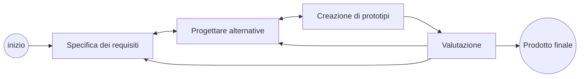

# 03 - Interaction Design

> Fonte: [[IUM/TEORIA/PDF/03-design-process.pdf]]
> Slide di Davide Spano (CC BY-SA 4.0); la parte sul Task-Artifact Cycle è tratta dalle slide di Albrecht Schmidt

**Domande guida**
- Quali fattori sono coinvolti nel design dell'interazione? Perché e quanto coinvolgere gli utenti? Cos'è un approccio *user-centered*?
- Chi sono gli utenti e quali sono i loro bisogni? Da dove vengono le alternative di design e come si sceglie tra di esse?

---

## 1. Fattori dell'interaction design

Il design dell'interazione è:
- **un processo**: attività guidata da un obiettivo, influenzata dall'uso previsto, dal dominio applicativo, dai materiali, dai costi e dalla fattibilità;
- **un'attività creativa**;
- **un bilanciamento tra trade-off**.

### Quattro approcci principali

| Approccio | Chi/cosa guida il design |
|---|---|
| **User-centered design** | L'**utente**: il designer progetta la soluzione in base ai suoi **bisogni** |
| **Activity-centered design** | Il **comportamento** necessario per eseguire un task |
| **System design** | Progettazione **rigorosa** di un sistema che risolve un problema preciso |
| **Genius design** | Solo l'**esperienza del designer** |

## 2. Coinvolgere gli utenti

| Motivo | Dettagli |
|---|---|
| **Gestione delle aspettative** | Aspettative realistiche: nessuna sorpresa né delusione; apprendimento tempestivo; comunicazione, ma senza "vendere fumo" |
| **Senso di proprietà** | Gli utenti diventano parte attiva del processo, capiscono e accettano più facilmente i problemi; può essere cruciale perché il prodotto venga **accettato** |

## 3. L'approccio user-centered

Caratteristiche:
1. **Attenzione ai task fin dalle prime fasi**: si studiano le caratteristiche cognitive, comportamentali e attitudinali degli utenti.
2. **Misurazione empirica**: prestazioni degli utenti in scenari applicativi, anche a prodotto finito, con registrazione delle interazioni.
3. **Design iterativo**: quando un test utente rivela un problema, lo si risolve e si testa di nuovo.

## 4. Che cosa si intende per bisogni?

- Gli utenti raramente sanno cosa è possibile (e quindi cosa non lo è), e non sanno dire cosa servirebbe per aiutarli.
- Ci si può concentrare invece sui **task esistenti**: il loro **contesto**, le **informazioni** necessarie, **chi collabora** all'attività e **perché** l'obiettivo è raggiunto nel modo attuale.
- I compiti previsti per l'applicazione possono essere **radicati nel comportamento attuale** oppure descritti come **scenari futuri**.

### La gerarchia dei bisogni di Maslow

![[IUM03-piramide-maslow.jpg|500]]

Dal basso verso l'alto: **fisiologici** → **sicurezza** → **appartenenza** (amore, amicizia) → **stima** → **autorealizzazione**.

> [!question] Esercizio
> Posizionare nella piramide: 1) Instagram, 2) Google Maps, 3) Tinder.

## 5. Il ciclo Task-Artifact (Carroll, 1990)

1. Le persone hanno **bisogni e preferenze**.
2. Si creano **tecnologie** (artefatti) per soddisfarli.
3. Usando le tecnologie, **bisogni e preferenze cambiano** → nuovi requisiti → nuovi artefatti…

![[IUM03-ciclo-task-artifact.png|450]]

> [!quote] Carroll (2013)
> *"Human activities implicitly **articulate needs**, preferences and design visions. **Artifacts are designed in response**, but inevitably do more than merely respond. Through the course of their adoption and appropriation, **new designs provide new possibilities** for action and interaction. Ultimately, this activity articulates **further human needs**, preferences, and design visions."*

**Esempi**
- **Mobilità**: necessità di trasporto → automobile → cambiano la mobilità e la **struttura stessa delle città** (confronto tra un centro storico e una città pianificata per le auto su OpenStreetMap).
- **Comunicazione**: desiderio di comunicare → telefono (cellulare) → cambia il comportamento sociale → …

> [!question] Esercizio
> 1. Spiegare il ciclo task-artifact nel contesto della telefonia mobile.
> 2. Come si davano appuntamento le persone in città nel 1990? E nel 2020? Discutere l'impatto oltre il singolo artefatto.

## 6. Iterazioni: generare e scegliere alternative

Il design si può vedere come la ricerca del punto più alto in un "paesaggio" di soluzioni.

| Strategia | Idea |
|---|---|
| **Miglioramento** di un approccio | Si parte da un'idea e la si raffina passo dopo passo, salendo sulla stessa "collina" (rischio: un ottimo **locale**) |
| **Esplorazione** | Si generano idee molto diverse, sparse su "colline" diverse, per trovare la direzione più promettente |

![[IUM03-iterazioni-miglioramento.png|420]] ![[IUM03-iterazioni-esplorazione.png|300]]

### Elaborazione e riduzione
- Si generano **molte idee**, nei modi più diversi (**elaborazione**, *opportunity seeking*).
- Si riflette sulle idee per migliorarle.
- Si **selezionano** le più promettenti (**riduzione**, *decision-making*).
- Strada facendo si considerano nuove idee man mano che arrivano.

Il processo alterna continuamente fasi divergenti e convergenti:

![[IUM03-elaborazione-riduzione.png|420]]
![[IUM03-elaboration-reduction.png|420]]

## 7. Le fasi (comuni) del processo

Esistono molte definizioni simili del processo (es. il **Design Thinking** dell'Interaction Design Foundation: *Empathize → Define → Ideate → Prototype → Test*, non lineare). **Il processo in sé ha importanza relativa: conta cosa si fa al suo interno.**

![[IUM03-design-thinking.jpg|380]]

> [!question] Esercizio
> Leggere il caso di studio del redesign della homepage di Nielsen Norman Group: <https://www.nngroup.com/articles/case-study-iterative-design-prototyping/>

## Riferimenti
- Dix, Finlay, Abowd, Beale — *Interazione Uomo Macchina*, cap. 5
- Rogers, Sharp, Preece — *Interaction Design*, cap. 9–11
- Approfondimento: B. Buxton — *Sketching user experiences*
- J. M. Carroll (1990). *Infinite detail and emulation in an ontologically minimized HCI*. CHI '90.

---

## Termini e concetti da ricordare

- **Interaction design**: processo guidato da obiettivi, creativo, fatto di trade-off.
- **4 approcci**: user-centered, activity-centered, system design, genius design.
- **Coinvolgere gli utenti**: gestione delle aspettative + senso di proprietà → accettazione del prodotto.
- **User-centered design**: focus precoce su utenti e task · misurazione empirica · **design iterativo**.
- **Bisogni**: gli utenti non sanno cosa è possibile → si studiano i **task esistenti** e il loro contesto.
- **Piramide di Maslow**: fisiologici, sicurezza, appartenenza, stima, autorealizzazione.
- **Ciclo Task-Artifact** (Carroll 1990): bisogni → artefatti → nuovi bisogni.
- **Miglioramento vs esplorazione** (ottimo locale vs ricerca ampia).
- **Elaborazione** (divergere, generare idee) e **riduzione** (convergere, scegliere).
- **Fasi del processo**: requisiti → alternative → prototipi → valutazione, in ciclo fino al prodotto finale.
- **Design Thinking**: Empathize, Define, Ideate, Prototype, Test.
