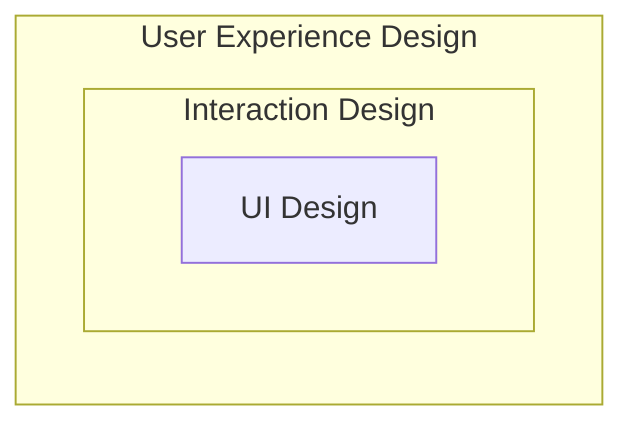

# 03 - Definizioni e Terminologia

## Definizione di Human-Computer Interaction

> "Human-computer interaction is a discipline concerned with the **design, evaluation and implementation of interactive computing systems for human use** and with the study of major phenomena surrounding them."
> — *ACM SIGCHI Curricula*, 1992

**Definizione pragmatica (da informatici)**: come abilitare l'interazione tra **uno o più esseri umani** e **uno o più dispositivi computazionali** e con i **dati**.

## Sistemi interattivi

Un **sistema interattivo** è un sistema computazionale che consente agli utenti di interagire **in tempo reale**¹. Le interazioni ricevono un **feedback immediato**, visibile all'utente.
*Interactive computing* si usa in modo simile, con minore enfasi sul "sistema".

**Esempi**
- Interfacce grafiche (GUI) come Windows o macOS
- Dispositivi mobili, come un telefono Android
- Console per giochi (Xbox, Nintendo Switch)
- Macchine erogatrici di biglietti (es. quelle dei treni)
- Interfacce a riga di comando (es. console SSH)

¹ "Tempo reale" qui indica risposte del sistema che rientrano in un intervallo percepito dall'utente come **istantaneo**: in pratica tipicamente **< 100 ms**.

> [!tip] Approfondimento – Le "potenze di 10" dei tempi di risposta (Nielsen)
> Jakob Nielsen individua tre soglie classiche:
> - **0,1 s** → l'utente percepisce la reazione come **istantanea** (manipolazione diretta, nessun feedback speciale necessario);
> - **1 s** → il flusso di pensiero non si interrompe, ma si nota il ritardo;
> - **10 s** → limite per mantenere l'attenzione sul compito: oltre serve un indicatore di avanzamento (progress bar), altrimenti l'utente passa ad altro.
>
> Le interazioni possono essere avviate dall'utente oppure dal sistema stesso (**sistemi proattivi**, es. notifiche).

## Interfaccia utente

- È la **parte di un sistema con cui l'utente può interagire** (sistema, dispositivo o applicazione).
- Può supportare **input, output o entrambi**.
- **Non è limitata alle tecnologie digitali** né ai sistemi interattivi (anche il cruscotto di un'auto è un'interfaccia).
- Termini simili: *Human-Computer Interface* (HCI), *Man-Machine Interface* (MMI) o *Human-Machine Interface* (HMI).

**Esempi**: la GUI di una pagina web; l'interfaccia vocale di uno smart speaker (es. Alexa); pulsanti, interruttori, manopole e leve nella cabina di pilotaggio di un aereo.

## Utente, contesto, sistema interattivo e interfaccia (ISO 9241-210:2019)

| Termine | Definizione ISO |
| --- | --- |
| **Utente** (*user*) | "persona che interagisce con il sistema, prodotto o servizio" |
| **Contesto d'uso** | "combinazione di utenti, obiettivi e compiti, risorse e ambiente" |
| **Sistema interattivo** | "combinazione di hardware e/o software e/o servizi e/o persone con cui gli utenti interagiscono per raggiungere un determinato obiettivo" |
| **Interfaccia utente** | "tutti i componenti di un sistema interattivo (software o hardware) che forniscono informazioni e permettono il controllo all'utente per completare specifici compiti con il sistema interattivo" |

> [!tip] Approfondimento – ISO 9241-210
> È lo standard "*Ergonomics of human-system interaction – Part 210: Human-centred design for interactive systems*". Oltre alle definizioni, descrive il **processo di progettazione centrata sull'umano** (capire il contesto d'uso → specificare i requisiti → produrre soluzioni di design → valutarle, in modo iterativo), che riprenderemo in [[04 - Interaction Design]]. La parte 11 della stessa norma (ISO 9241-11) definisce l'usabilità come *"il grado in cui un prodotto può essere usato da specifici utenti per raggiungere specifici obiettivi con **efficacia, efficienza e soddisfazione** in uno specifico contesto d'uso"*.

## Design dell'interfaccia utente e dell'interazione

**User Interface Design**: concezione e progettazione dell'interfaccia, inclusa la **scelta delle modalità** (es. grafica, vocale, tattile), la **selezione degli elementi** dell'interfaccia e il loro **posizionamento**.

**Interaction Design**:
- Preece, Rogers e Sharp (2002): *"Progettare prodotti interattivi per supportare le persone nella loro vita quotidiana e lavorativa."*
- Winograd (1997): *"La progettazione di spazi per la comunicazione e l'interazione umana."*

## Interaction Design vs User Experience Design

- **Interaction Design (IxD)**: *"progettazione di prodotti e servizi interattivi in cui l'attenzione del designer va oltre l'oggetto in sviluppo, **includendo il modo in cui gli utenti interagiranno con esso**."* (Interaction Design Foundation)
- **User Experience Design (UX)**: approccio **più olistico**, che progetta l'**esperienza complessiva** che una persona vivrà interagendo con un dispositivo, sistema o applicazione. Considera il design dell'interfaccia all'interno di un **contesto d'uso più ampio** (aspettative, emozioni, prima e dopo l'uso…).

## Utilità, Usabilità, Piacevolezza

- **Utilità** (*usefulness*): il prodotto serve a raggiungere un obiettivo o completare un compito. **Essenziale!**
- **Usabilità** (*usability*): riguarda la **qualità e l'efficienza** — quanto bene il prodotto supporta l'utente nel raggiungere l'obiettivo o svolgere il compito.
- **Piacevolezza** (*likeability*): può essere correlata a utilità e usabilità, ma non necessariamente. Le persone possono apprezzare un prodotto per qualsiasi altro motivo (estetica, moda, status…).

## Cos'è l'usabilità: la definizione di Jakob Nielsen

> "L'**usabilità** è un **attributo di qualità** che valuta quanto siano facili da usare le interfacce utente. Il termine si riferisce anche ai **metodi** volti a migliorare la facilità d'uso durante il processo di progettazione."
> — J. Nielsen, *Usability 101* (2003)

### Le cinque componenti dell'usabilità (Nielsen)

| Componente | Domanda chiave |
| --- | --- |
| **Apprendibilità** (*Learnability*) | Quanto è facile svolgere le attività di base la **prima volta** che si incontra il design? |
| **Efficienza** (*Efficiency*) | Una volta imparato il design, **quanto velocemente** si eseguono le attività? |
| **Retentività / Memorabilità** (*Memorability*) | Tornando al design **dopo un periodo di inattività**, quanto facilmente si recupera la competenza? |
| **Errori** (*Errors*) | Quanti errori si commettono, **quanto sono gravi** e quanto è facile **recuperare**? |
| **Soddisfazione** (*Satisfaction*) | Quanto è **piacevole** usare il design? |

> [!example] Esempio
> Un software professionale di montaggio video può avere bassa *apprendibilità* (all'inizio è difficile) ma altissima *efficienza* per chi lo conosce (scorciatoie da tastiera). Un'app per fare il check-in in aeroporto, usata due volte l'anno, deve invece puntare su apprendibilità e memorabilità.

## HCI e la "fuffa"…

Il docente ha chiesto a ChatGPT i 10 aggettivi più usati nel marketing per descrivere le UI. Alcuni **non vogliono dire nulla** di misurabile e **non vanno usati in questo corso** (ad esempio nelle relazioni di progetto):

1. **Intuitive** – facile da capire e usare senza istruzioni
2. **User-friendly** – comoda e piacevole
3. **Responsive** – si adatta a diversi dispositivi e dimensioni dello schermo
4. **Clean** – visivamente ordinata, senza elementi superflui
5. **Modern** – aggiornata nello stile
6. **Fast** – veloce nel caricamento e nelle risposte
7. **Simple** – chiara, con funzioni facilmente comprensibili
8. **Attractive** – esteticamente piacevole
9. **Seamless** – esperienza fluida, senza interruzioni
10. **Interactive** – permette di compiere azioni o ricevere feedback immediati

> [!warning] Perché sono "fuffa"
> Termini come *intuitiva* o *user-friendly* sono vaghi e non verificabili. Al loro posto conviene usare le componenti misurabili dell'usabilità: es. "un nuovo utente completa la registrazione in meno di 2 minuti senza aiuto" (apprendibilità), "il tasso di errore nel pagamento è < 2%" (errori), ecc.

## Riferimenti
- Hewett et al. (1992). *ACM SIGCHI Curricula for Human-Computer Interaction*. ACM.
- ISO 9241-210:2019 – https://www.iso.org/obp/ui/#iso:std:iso:9241:-210:ed-2:v1:en
- Y. S. Teo – *What is Interaction Design?* https://www.interaction-design.org/literature/article/what-is-interaction-design
- J. Nielsen (2003). *Usability 101: Introduction to Usability*. https://www.nngroup.com/articles/usability-101-introduction-to-usability/
- J. Nielsen (2009). *Powers of 10: Time Scales in User Experience*. https://www.nngroup.com/articles/powers-of-10-time-scales-in-ux/
- Preece, Rogers, Sharp (2002). *Interaction Design*, cap. 9.
- T. Winograd (1997). *From computing machinery to interaction design*.
- Moggridge (2007). *Designing Interactions*, MIT Press (intervista a Gillian Crampton Smith).
- Pine & Gilmore (1998). *Welcome to the experience economy*. Harvard Business Review.
- M. Hassenzahl (2013). *User Experience and Experience Design*. Encyclopedia of HCI.
- Law, Roto, Hassenzahl et al. (2009). *Understanding, scoping and defining user experience: a survey approach*. CHI '09.
