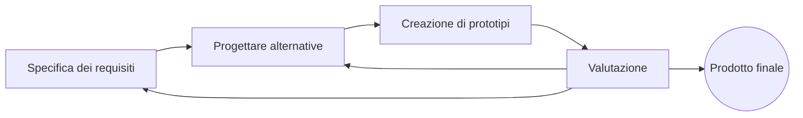

# 04 - Interaction Design

## Sommario
- **Quali fattori sono coinvolti nel design dell'interazione?**
  - Importanza di coinvolgere gli utenti
  - Grado di coinvolgimento degli utenti
  - Cos'è un approccio incentrato sugli utenti?
  - Quattro attività di base
- **Considerazioni pratiche**
  - Chi sono gli utenti?
  - Quali sono i loro bisogni?
  - Da dove vengono fuori le alternative?
  - Come si sceglie tra le alternative?

## Fattori dell'interaction design

È un **processo**:
- un'attività **guidata da un obiettivo**, influenzata dall'uso previsto dell'applicazione, dal dominio applicativo, dai materiali, dai costi e dalla fattibilità;
- un'attività **creativa**;
- richiede un **bilanciamento tra diversi trade-off**.

### Quattro approcci principali

| Approccio | Chi/cosa guida il design |
| --- | --- |
| **User-centered design** | L'**utente** è la guida: il designer progetta una soluzione in base ai suoi *bisogni*. |
| **Activity-centered design** | Si focalizza sul **comportamento** necessario per eseguire un task (le attività, più che le persone). |
| **System design** | Progettazione **rigorosa** di un sistema che deve risolvere un problema preciso (approccio ingegneristico: componenti, obiettivi, feedback). |
| **Genius design** | Usa **solo l'esperienza** (e l'intuito) del designer, senza coinvolgere gli utenti. |

> [!tip] Approfondimento – Quando usare quale approccio
> Le definizioni vengono da Dan Saffer (*Designing for Interaction*). Nessun approccio è "sbagliato": il **genius design** è rapido ed economico ma rischioso se il designer non conosce bene il dominio (es. Apple viene spesso citata come esempio); l'**activity-centered** funziona bene quando gli utenti sono molto diversi ma svolgono le stesse attività (es. un'app per spedire pacchi); il **system design** è adatto a sistemi complessi con molte parti interconnesse; lo **user-centered** è quello di riferimento del corso.

## L'importanza di coinvolgere gli utenti

**Gestione delle aspettative**
- Aspettative **realistiche**: nessuna sorpresa, nessuna delusione.
- **Apprendimento tempestivo** del sistema.
- Comunicazione, ma senza "vendita di fumo".

**Senso di proprietà** (*ownership*)
- Rendere gli utenti **parti attive** nel processo.
- È più probabile che **capiscano/accettino i problemi**.
- Può essere cruciale perché il prodotto venga **accettato**.

> [!tip] Approfondimento – Grado di coinvolgimento degli utenti
> Nominato nel sommario: il coinvolgimento può andare da un estremo all'altro:
> - **basso**: gli utenti vengono solo osservati o intervistati in alcuni momenti (raccolta requisiti, test finali);
> - **medio**: gli utenti partecipano periodicamente a workshop, valutazioni di prototipi;
> - **alto**: utenti nel team a tempo pieno (**design partecipativo / co-design**).
>
> Più coinvolgimento significa più informazioni e accettazione, ma anche più costi e il rischio che gli utenti coinvolti diventino "troppo esperti" e non rappresentativi.

## Cos'è un approccio user-centered?

Caratteristiche (Gould & Lewis):
1. **Focus precoce su utenti e task**: dalle prime fasi dello sviluppo si studiano le caratteristiche cognitive, comportamentali e attitudinali degli utenti.
2. **Misurazione empirica**: si misurano le prestazioni degli utenti in scenari applicativi, anche a prodotto finito, registrando le interazioni.
3. **Design iterativo**: quando un test utente rileva un problema, lo si risolve e si fanno altri test.

## Che cosa si intende per bisogni?

- Gli utenti **raramente sanno cosa sia possibile** (e quindi cosa non lo sia).
- Gli utenti **non possono dirti cosa serve** per aiutarli a raggiungere un obiettivo.
- Ci si può però concentrare sui **task esistenti**:
  - il loro contesto;
  - di che informazioni hanno bisogno;
  - chi collabora all'attività;
  - **perché** l'obiettivo è raggiunto nel modo attuale.
- I compiti previsti per l'applicazione:
  - possono essere radicati nel comportamento attuale;
  - possono essere descritti come **scenari futuri** (vedi [[06 - Scenari]]).

> [!quote] "Se avessi chiesto alle persone cosa volevano, mi avrebbero risposto: cavalli più veloci." (attribuita a Henry Ford)

### La gerarchia dei bisogni di Maslow

![[ium_p04_s07.jpg]]

Dal basso verso l'alto:
1. **Fisiologici** – respirare, mangiare, bere, dormire, omeostasi…
2. **Sicurezza** – del corpo, del lavoro, delle risorse, della famiglia, della salute, della proprietà
3. **Amore / Appartenenza** – amicizia, famiglia, intimità
4. **Stima** – autostima, fiducia, realizzazione, rispetto degli altri
5. **Autorealizzazione** – moralità, creatività, spontaneità, problem solving, accettazione dei fatti

> [!example] Esercizio – Posiziona le app nella piramide
> 1. **Instagram** → soprattutto **stima** (like, riconoscimento sociale) e **appartenenza** (relazioni con amici).
> 2. **Google Maps** → **sicurezza** (orientarsi, non perdersi, sapere dove si trova un ospedale) e supporto ai bisogni pratici quotidiani.
> 3. **Tinder** → **amore/appartenenza** (relazioni, intimità), in parte anche **stima**.
>
> *(Soluzione proposta: non c'è una risposta unica, conta la motivazione.)*

## Il ciclo Task-Artifact di Carroll (1990)

- Le persone hanno **bisogni e preferenze**.
- Le tecnologie vengono create per soddisfarli.
- Quando le persone usano le tecnologie, **bisogni e preferenze cambiano**.

![[ium_p04_s09b.png]]

> "Human activities implicitly **articulate needs**, preferences and design visions. **Artifacts are designed in response**, but inevitably do more than merely respond. Through the course of their adoption and appropriation, **new designs provide new possibilities** for action and interaction. Ultimately, this activity articulates **further human needs**, preferences, and design visions."
> — J. M. Carroll

In sintesi: **task → requisiti → idee di design → artefatti → adozione e uso → nuove possibilità → nuovi task**, all'infinito.

### Esempio: la mobilità

![[ium_p04_s11.jpg]]

Necessità di trasporto → **automobile** → cambiamento della mobilità e della **struttura delle città** (a sinistra un centro storico medievale pensato per pedoni, a destra una città a griglia con strade larghe pensata per le auto). L'artefatto ha creato bisogni nuovi (parcheggi, autostrade, periferie…).

## Iterazioni

### Miglioramento di un approccio
![[ium_p04_s13.jpg]]

Partendo da un'idea, le iterazioni la migliorano progressivamente ("salgono la collina"). Il rischio è arrivare al **massimo locale** dell'idea di partenza senza sapere se esistono soluzioni migliori.

### Esplorazione
![[ium_p04_s14.png]]

Esplorare **più idee diverse** permette di trovare "colline" più alte (soluzioni globalmente migliori), invece di raffinare solo la prima idea.

> [!tip] Approfondimento
> È la distinzione di Bill Buxton tra *getting the design right* (fare bene il design scelto → migliorare un approccio) e *getting the right design* (scegliere il design giusto → esplorare alternative). Prima si esplora, poi si raffina.

### Elaborazione e riduzione
![[ium_p04_s15.png]]

- Si generano **molte idee**, nei modi più diversi.
- Si **riflette** sulle idee per migliorarle.
- Si **selezionano** le più promettenti.
- Strada facendo si considerano **nuove idee** quando arrivano.

![[ium_p04_s16.png]]

Il processo di design alterna fasi di **elaborazione** (*opportunity seeking*: si allarga lo spazio delle idee, pensiero divergente) e fasi di **riduzione** (*decision making*: si scelgono le alternative migliori, pensiero convergente).

## Le fasi (comuni) del processo

Queste sono anche le **quattro attività di base** dell'interaction design (Preece, Rogers, Sharp):
1. **Stabilire i requisiti** → [[05 - Requisiti e Personas]]
2. **Progettare alternative** (design concettuale e fisico)
3. **Prototipare** → [[07 - Creazione di prototipi]]
4. **Valutare**

### Definizioni di processo simili
- Il processo in sé ha **importanza relativa**.
- È importante cosa **fai** nel processo.

![[ium_p04_s18.jpg]]

> [!tip] Approfondimento – Design Thinking
> Il **Design Thinking** (Interaction Design Foundation / d.school di Stanford) è un processo **non lineare** in 5 fasi:
> 1. **Empathize** – capire gli utenti (osservazione, interviste);
> 2. **Define** – definire il problema e i bisogni;
> 3. **Ideate** – generare idee;
> 4. **Prototype** – costruire rappresentazioni delle idee;
> 5. **Test** – provarle con gli utenti.
>
> I test spesso riportano a fasi precedenti (nuovi insight → ridefinizione del problema, nuove idee).

## Esercizio: leggere il report

Nielsen Norman Group – *Homepage redesign*: https://www.nngroup.com/articles/case-study-iterative-design-prototyping/

> [!tip] Approfondimento – Contenuto del case study
> NN/g racconta il redesign della propria homepage: hanno prodotto **molte alternative** con prototipi a bassa fedeltà (sketch/wireframe), le hanno testate con utenti, scartate o combinate, e sono passati a prototipi sempre più fedeli solo dopo diversi cicli. È un esempio concreto di processo **iterativo** con **esplorazione** iniziale e **riduzione** progressiva.

## Riferimenti
- Dix, Finlay, Abowd, Beale – *Interazione Uomo Macchina*, cap. 5
- Rogers, Sharp, Preece – *Interaction Design*, cap. 9-10-11
- Approfondimento: Bill Buxton – *Sketching user experiences*
- J. M. Carroll (1990). *Infinite detail and emulation in an ontologically minimized HCI*. CHI '90. https://doi.org/10.1145/97243.97303
