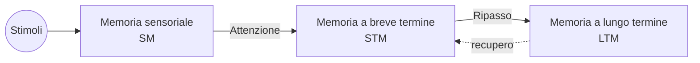
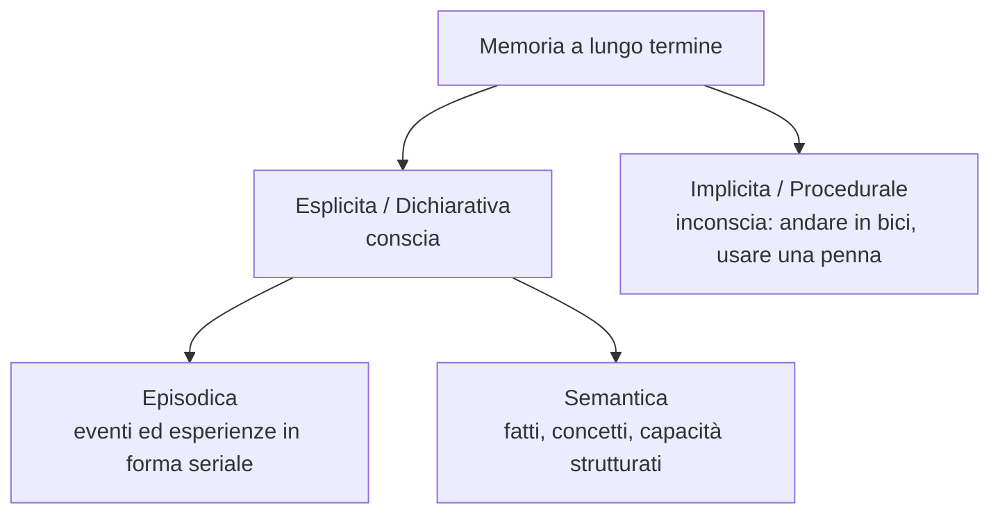

# 12 - Memoria

## Cos'è la memoria

Insieme di **processi cognitivi** che regolano:
- la capacità di **apprendere dall'esperienza**;
- la capacità di **pianificare comportamenti futuri**.

Tre fasi distinte:
1. **Acquisizione** (codifica): percezione del materiale da apprendere;
2. **Ritenzione** (immagazzinamento): trasformazione dell'informazione in ricordi;
3. **Recupero**: rievocazione del ricordo dalla memoria.

Useremo un **modello schematico** con tre tipologie principali di memoria.

## Tipi di memoria

![[ium_p12_s03.jpg]]



| Memoria | Durata | Capacità |
| --- | --- | --- |
| **Sensoriale** (SM) | 200–500 ms | limitatissima |
| **A breve termine** / di lavoro (STM) | da pochi secondi a un minuto | limitata |
| **A lungo termine** (LTM) | potenzialmente tutta la vita | enorme (illimitata?) |

> [!tip] Approfondimento
> È il **modello modale** (o multi-magazzino) di Atkinson e Shiffrin (1968): l'informazione passa dalla SM alla STM grazie all'**attenzione**, e dalla STM alla LTM grazie al **ripasso** (*rehearsal*).

## Memoria sensoriale

Sono **buffer** (memorie tampone) che registrano **temporaneamente** gli stimoli sensoriali:
- **Memoria iconica**: stimoli **visivi**;
- **Memoria ecoica**: stimoli **uditivi**;
- **Memoria aptica**: stimoli **tattili**.

*Esempi*:
- **fuochi d'artificio** (iconica): vediamo una "scia" luminosa perché l'immagine persiste;
- **direzione del suono** (ecoica): confrontiamo il suono arrivato alle due orecchie in istanti leggermente diversi.

- Il buffer viene **sovrascritto continuamente** (persistenza massima: **~2 s ecoica**, **~300 ms iconica**).
- Permette di estrarre informazioni in modo **"differenziale"**, cioè quando serve valutare **traiettorie** e **direzioni** (confronto tra lo stato attuale e quello appena precedente).

> [!example] Test della memoria sensoriale
> Viene mostrata per un istante una griglia di lettere:
> ```
> Z X E G
> U K S O
> B M C V
> ```
> Quante lettere riesci a riportare? Di solito solo 4–5.
>
> **Approfondimento – Esperimento di Sperling (1960)**: se, subito dopo la scomparsa della griglia, un suono indica **quale riga** riportare (alto = prima, medio = seconda, basso = terza), i soggetti ne ricordano quasi tutte le lettere. Quindi per un istante **l'intera griglia è nella memoria iconica**, ma svanisce prima che si riesca a "leggerla" tutta (*resoconto parziale* vs *resoconto totale*).

## Attenzione

- L'attenzione è la **selezione degli stimoli** in base all'**interesse** (*arousal*).
- Per non essere **sovraccaricati** dobbiamo selezionare gli stimoli.
- La selezione è determinata dal livello di **interesse** o di **necessità**.

*(Esempio: in una stazione affollata, tra migliaia di stimoli notiamo l'annuncio del nostro treno.)*

## Memoria a breve termine (STM)

- **Registrazione temporanea** dell'informazione oggetto dell'elaborazione in corso.
- Funziona come una **memoria di lavoro** (una **cache**): ad esempio, per capire una frase bisogna ricordarla tutta dall'inizio.
- Caratteristiche:
  - **accesso rapido**: ~70 ms;
  - **decadimento altrettanto rapido**: ~200 ms;
  - **capacità limitata**: **7 ± 2 blocchi** di informazione (*chunks*) — G. Miller, *"The magical number seven, plus or minus two"* (1956).
- ⚠️ I blocchi da contare sono quelli che l'utente **deve ricordare**: nei **menu**, per esempio, le scelte sono **visibili** e fanno da suggerimento, quindi non occupano la STM (la regola "max 7 voci per menu" è un'applicazione errata di Miller).

> [!example] Test della STM
> Prova a ricordare queste righe:
> ```
> 674893976233123
> 0323 565 2323 9482
> ADO GLO STI NTH EWO ODS
> A DOG LOST IN THE WOODS
> ```
> - La prima (15 cifre di fila) è quasi impossibile;
> - la seconda (stesse dimensioni ma divisa in 4 gruppi) è più facile;
> - la terza (lettere raggruppate a caso) è difficile;
> - la quarta (**le stesse lettere** della terza, ma raggruppate in parole con significato) è facilissima: sono solo 6 chunk, anzi 1 frase.

### Struttura a blocchi (*chunking*)
- La STM si organizza in **chunk**, cioè gruppi di informazione consistenti.
- Così è possibile **aumentarne la capacità**.
- Non è un caso che memorizziamo i numeri di telefono a blocchi: `0706758540` → `070 675 85 40`.
- La formazione di un singolo blocco è detta **chiusura** (*closure*).
- Quando raggiungiamo il nostro obiettivo **svuotiamo la memoria a breve termine**.
- Quindi bisogna **evitare azioni da compiere dopo aver raggiunto l'obiettivo**:
  - es. ritirare il bancomat **dopo** aver prelevato i soldi → si dimentica la carta;
  - è il **post-completion error**. Per questo oggi gli ATM restituiscono la carta **prima** dei soldi (e le fotocopiatrici fanno "bip" se si dimentica l'originale).

### Interferenze
- Interferenze durante la memorizzazione disturbano il mantenimento in STM.
- Il ricordo di quanto visto **più di recente** è migliore di quello di cose precedenti → **recency effect** (effetto recenza).
- L'effetto **scompare** se tra presentazione e ricordo il soggetto viene impegnato con un **altro compito**.
- Per questo l'essere umano ha bisogno di **completare senza distrazioni** i compiti che impegnano la STM.

> [!tip] Approfondimento – Primacy effect
> Ricordando una lista si ricordano meglio sia gli **ultimi** elementi (*recency*, ancora in STM) sia i **primi** (*primacy*, ripassati più volte e quindi passati in LTM): è la **curva di posizione seriale**. Gli elementi centrali sono i più dimenticati.

### Il modello di Baddeley

![[ium_p12_s12.jpg]]

Baddeley e Hitch (1974, esteso nel 2000) descrivono la memoria di lavoro come composta da **quattro componenti**:
- **Esecutivo centrale**: supervisore che **gestisce le risorse limitate** di memoria e **coordina** gli altri sottosistemi;
- **Taccuino visuo-spaziale** (*visuo-spatial sketchpad*): mantiene ed elabora informazione **visuo-spaziale** e **aptica**;
- **Loop fonologico** (*phonological loop*): mantiene ed elabora informazione **verbale e acustica** (la "voce interiore" che ripete un numero di telefono);
- **Buffer episodico**: **integra** l'informazione degli altri sistemi tra loro e con quella della **memoria a lungo termine**.

**Si ha interferenza solo se si impegna ripetutamente lo stesso componente**: possiamo ascoltare un podcast mentre guardiamo un paesaggio, ma non leggere un testo mentre qualcuno ci parla.

### STM: implicazioni di progetto
- Supportare l'utente **riducendo il più possibile l'uso della memoria di lavoro**.
- **Non chiedere mai** all'utente di ricordare, anche per poco, gli **stati operativi** del sistema.
- Indicare **sempre lo stato** in cui si trova il processo corrente (es. "passo 2 di 4").
- Aiutare sempre l'utente a capire **qual è il prossimo input** che il sistema si aspetta.

> [!example] Esempi
> Un wizard di checkout con indicatore di avanzamento; il riepilogo dell'ordine visibile durante il pagamento; il codice OTP che si può incollare invece di doverlo ricordare e ricopiare.

## Memoria a lungo termine (LTM)

- **Archivio** di tutta la nostra conoscenza (ciò che sappiamo).
  - **Accesso più lento**: ~0,1 s;
  - **decadimento lento o nullo**, a seconda delle informazioni;
  - **capacità enorme** (illimitata?).



- **Esplicita o dichiarativa**: tutte le memorie disponibili in modo **conscio**.
  - **Episodica**: memoria di **eventi ed esperienze**, in forma seriale (cosa ho fatto ieri).
  - **Semantica**: memoria **strutturata** di **fatti, concetti e capacità** (Roma è la capitale d'Italia).
  - L'informazione semantica **deriva** da quella episodica: impariamo fatti e concetti **dalle esperienze**.
- **Implicita o procedurale**: le informazioni che usiamo **senza rendercene conto** (come usare una penna, andare in bicicletta, digitare su tastiera).

⚠️ Non confondere la memoria umana con quella di un computer: è **distribuita** in varie parti del cervello che interagiscono tra loro.

### La struttura della memoria semantica
La memoria semantica è strutturata in modo da:
- fornire **accesso** alle informazioni;
- rappresentare le **relazioni** tra le informazioni;
- supportare il **ragionamento** (inferenza).

Esistono vari **modelli** (complementari, non mutuamente esclusivi), tutti poi ripresi in informatica (intelligenza artificiale, rappresentazione della conoscenza):
- reti semantiche
- frames
- scripts
- regole di produzione

#### Reti semantiche
- Modello a **rete**, rappresentato come un **grafo diretto**:
  - **ereditarietà**: i nodi figli ereditano le proprietà dei nodi padri;
  - **relazioni esplicite** tra elementi informativi;
  - supporta la **deduzione** attraverso l'ereditarietà.

![[ium_p12_s19.png]]

*Esempio: ANIMAL (breathes, moves) → is a → DOG (has four legs, barks, has tail) → is a → COLLIE (size: medium; colour: brown/white…) → instance → LASSIE (film character). Sapendo che Lassie è un collie, deduciamo che abbaia e respira senza averlo memorizzato esplicitamente.*

#### Frames
- Informazione organizzata in una **struttura dati** (come una classe/record).
- I **campi** sono riempiti con valori specifici per un certo esemplare.
- Le relazioni sono di tipo **tipo–sottotipo**.

```
DOG                         COLLIE
  Fixed                       Fixed
    legs: 4                     breed of: DOG
  Default                       type: sheepdog
    diet: carnivorous         Default
    sound: bark                 size: 65 cm
  Variable                    Variable
    size                        color
    color
```

- **Fixed**: valori sempre veri; **Default**: valori tipici, che possono essere sovrascritti; **Variable**: da riempire per ogni esemplare.

#### Scripts
- Rappresentano informazione **stereotipata**, necessaria per **interpretare situazioni**.
- Hanno elementi che rappresentano il **contesto**.
- Permettono di **ricostruire** situazioni "usuali" e di inferire ciò che non viene detto.

*Esempio*: "Giovanni ha portato il cane dal veterinario. Dopo aver visto il veterinario, è andato via." → capiamo che il cane è stato visitato e che Giovanni ha pagato, anche se non è scritto.

**Script: visita veterinaria**

| Elemento | Contenuto |
| --- | --- |
| **Situazione iniziale** | Il cane è ammalato; l'ambulatorio è aperto; il proprietario può pagare |
| **Risultati** | Il cane sta meglio; il proprietario ha meno soldi; il veterinario ha più soldi |
| **Proprietà** (oggetti) | Tabella degli esami, medicine, strumenti |
| **Ruoli/Compiti** | Il veterinario visita, fa la diagnosi e i trattamenti; il proprietario porta il cane in ambulatorio, paga, porta il cane fuori |
| **Scene** | Arrivo alla reception → attesa nella sala d'aspetto → visita → pagamento |
| **Tracce** (varianti) | Il cane ha bisogno di medicine; il cane ha bisogno di un intervento |

#### Regole di produzione
- Rappresentano la **conoscenza procedurale**.
- Regole **condizione → azione**: se la condizione è verificata, l'azione viene svolta.

```
SE il cane muove la coda  ALLORA accarezza il cane
SE il cane ringhia        ALLORA scappa
```

### I processi della LTM
Tre tipi di processi di gestione dell'informazione:
1. **Memorizzare** (archiviare)
2. **Dimenticare** (cancellare)
3. **Recuperare** (accedere)

#### Memorizzare
- L'informazione passa dalla STM alla LTM tramite **rehearsal** (reiterazione, ripetizione, studio).
- Il materiale può essere **organizzato**, creando connessioni e astrazioni.
- **Ipotesi del tempo totale**: la quantità di informazione memorizzata è **proporzionale al tempo di ripetizione** (più si studia, più si ricorda).
- **Distribution of practice effect**: a parità di tempo totale, si ottengono risultati migliori **distribuendo lo studio nel tempo** (meglio 1 ora al giorno per 5 giorni che 5 ore il giorno prima dell'esame).
- L'informazione è più facile da ricordare quando ha una **struttura**, un **significato** o riguarda argomenti **familiari**: i **concetti astratti** sono più difficili da ricordare degli **oggetti concreti**.

> [!example] Esperimento 1 – il valore della struttura
> Si mostrano nove simboli fatti di linee spezzate, ciascuno associato a una cifra da 1 a 9, e una sequenza da memorizzare (`1 8 4 7 2`). Imparare a memoria i simboli è difficile.
> Poi si rivela che **ogni simbolo è la forma della casella** corrispondente in una griglia del tris:
>
> ![[ium_p12_s26.png]]
>
> Conoscendo la regola, non serve memorizzare nulla: anche una sequenza lunga come `3 8 9 5 4 3 2 6 8 7` si scrive facilmente in simboli. **La struttura riduce il carico di memoria.**

#### Superiorità dell'immagine
- La LTM codifica l'informazione in modo diverso a seconda del **canale sensoriale**.
- **Allan Paivio** (anni '60) ipotizza due sistemi (**teoria della doppia codifica**):
  - **verbale**: gestisce le informazioni linguistiche (unità **logogene**);
  - **visivo**: gestisce le informazioni visive (unità **imagene**);
  - le **immagini** sono rappresentate in **entrambi** i sistemi;
  - le informazioni **verbali** solo con unità logogene.
- **Superiorità dell'immagine**: le immagini tendono a essere ricordate **più facilmente e più a lungo** dell'informazione verbale (doppia traccia = più vie di recupero). → Icone + etichetta funzionano meglio della sola etichetta.

#### Dimenticare
- **Decadimento**: l'informazione si perde **gradualmente** ma lentamente.
- **Interferenza**:
  - **interferenza retroattiva**: la nuova informazione rimpiazza la vecchia (il nuovo numero di telefono fa dimenticare il vecchio);
  - **inibizione proattiva**: la vecchia informazione interferisce con la nuova (tornare a casa vecchia invece che alla nuova).
- Le parole legate a **emozioni** si ricordano meglio di quelle legate a eventi "normali".
- Gli eventi **positivi** si ricordano meglio di quelli negativi (il luogo comune dei "bei tempi andati").
- **È davvero possibile dimenticare?** Non è ancora chiaro se l'informazione dimenticata sia stata davvero rimossa o sia solo molto **difficile da recuperare**.

> [!tip] Approfondimento – Interferenza nelle interfacce
> Quando un'app cambia la posizione o la scorciatoia di un comando dopo un aggiornamento, l'inibizione proattiva fa sì che gli utenti continuino a cercarlo nel vecchio posto: è uno dei motivi per cui i redesign radicali vengono spesso accolti male.

#### Recuperare
- **Ricordo** (*recall*): l'informazione viene **"ripescata"** dalla memoria; il processo può essere agevolato da **indizi**.
- **Riconoscimento** (*recognition*): la presentazione di un'informazione fa capire che è **già stata vista**. È **meno complesso** del ricordo, perché l'informazione presentata fa essa stessa da indizio.
- Indizi per aiutare il ricordo: uso di **categorie**, **visualizzazione**.

> [!important] Riconoscimento > ricordo
> È il motivo per cui le **GUI** (menu, icone, liste visibili) sono più facili da imparare delle **interfacce a riga di comando** (dove bisogna ricordare il nome del comando).

## Riferimenti
- Gamberini, Chittaro, Paternò – *Human Computer Interaction*, Pearson 2012, cap. 3 e 4
- Dix, Finlay, Abowd, Beale – *Human Computer Interaction*, cap. 1
