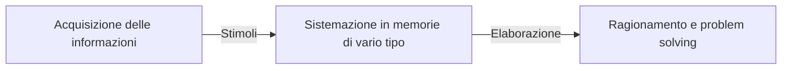

# 13 - Pensiero, ragionamento e metafore

> [!info] Il primo parziale arriva **fino alle metafore (incluse)**. Le slide successive della presentazione (*Acquisizione di esperienza*, *Cognizione e affettività*, *Emozioni*, *Differenze da considerare*) non sono riportate qui.

## Come pensa l'essere umano

- Il pensiero è probabilmente ciò che **distingue l'essere umano** dagli altri animali.
- L'essere umano usa il pensiero per due attività:
  - il **ragionamento**;
  - la **soluzione di problemi** (*problem solving*).

---

## Ragionamento

Processo con cui si usa la **conoscenza di cui si dispone** per **trarre conclusioni** o dedurre qualcosa di nuovo sul dominio di interesse.

Tre tipi: **deduttivo**, **induttivo**, **abduttivo**.

| Tipo | Direzione | Affidabilità | Esempio |
| --- | --- | --- | --- |
| **Deduttivo** | regola + causa → effetto | Logicamente valido (se le premesse sono vere) | "Se è venerdì va al lavoro; è venerdì ⇒ va al lavoro" |
| **Induttivo** | casi osservati → regola generale | Non affidabile (può solo falsificare) | "Tutti gli elefanti visti hanno la proboscide ⇒ tutti ce l'hanno" |
| **Abduttivo** | effetto + regola → causa più probabile | Non affidabile (false spiegazioni) | "Marco guida veloce ⇒ avrà bevuto" |

### Ragionamento deduttivo
Le conclusioni sono **logicamente derivate** dalle premesse date.
- Se è venerdì, lei andrà a lavorare
- È venerdì
- **Quindi**: lei andrà a lavorare

Si possono derivare conclusioni **logicamente corrette anche se non hanno senso**; le escludiamo grazie alla **conoscenza del mondo**:
- Se piove il terreno è asciutto
- Piove
- **Quindi**: il terreno è asciutto *(valida logicamente, ma la premessa è falsa)*

È anche facile **interpretare male** le regole della deduzione:
- Alcune persone sono bambini
- Alcuni bambini piangono
- **Quindi**: alcune persone piangono
- **Corretto?**

> [!question]- Risposta
> **No, dal punto di vista puramente logico.** La premessa dice che *alcune* persone sono bambini, non che *tutti* i bambini sono persone (questo lo sappiamo noi, ma non è esplicitato). Logicamente potrebbero esistere bambini che non sono persone, e i bambini che piangono potrebbero essere proprio quelli fuori dall'intersezione tra "persone" e "bambini". La conclusione è vera nel mondo reale, ma **non segue** dalle premesse: la nostra conoscenza del mondo ci fa "vedere" una deduzione che non c'è.

### Ragionamento induttivo
- **Generalizza** da casi visti a casi non visti: *tutti gli elefanti che ho visto hanno la proboscide, quindi tutti gli elefanti hanno la proboscide*.
- **Non è affidabile**: può provare solo la **falsità** di un'ipotesi (basta un controesempio), mai la sua verità.
- Però è molto utile per **costruire modelli**.
- L'essere umano usa meglio l'**evidenza positiva** che quella **negativa** → **le carte di Wason**.

### Le carte di Wason

![[ium_p13_s07.png]]

> *"Se una carta ha un numero **pari** su una faccia, allora la faccia opposta è **rossa**."* Ogni carta ha un numero da un lato e un colore dall'altro. **Quante e quali carte devo girare per scoprire se la regola è vera?**

> [!question]- Risposta
> L'istinto (ragionamento induttivo, cerco conferme) porta a girare l'**8** e la carta **rossa** (prove positive).
> In realtà bisogna girare:
> - l'**8**, per verificare che dietro sia rossa;
> - la carta **blu**, per verificare che dietro **non** ci sia un numero pari (sarebbe un controesempio).
>
> La carta rossa non serve: la regola non dice che dietro una carta rossa ci sia per forza un numero pari. Il 3 non serve (la regola non dice nulla sui dispari). *(Se non fosse garantito che ogni carta ha un numero da un lato e un colore dall'altro, bisognerebbe girare anche il 3.)*

![[ium_p13_s08.png]]

> *"Se bevi alcolici allora devi avere almeno diciotto anni."* Carte: **15**, **20**, **birra**, **Coca-Cola**.

> [!question]- Risposta
> Si girano il **15** (per vedere se beve alcolici) e la **birra** (per vedere se chi la beve ha almeno 18 anni). È **la stessa struttura logica** del problema precedente, ma qui quasi tutti rispondono correttamente: con un contenuto **familiare e concreto** (una regola sociale) ragioniamo molto meglio che con simboli astratti.

### Ragionamento abduttivo
- **Risalire dagli eventi alle cause**:
  - Marco guida veloce quando ha bevuto;
  - se vedo Marco guidare veloce, assumo che abbia bevuto.
- **Non affidabile**: può portare a **false spiegazioni** (magari Marco ha solo fretta).
- Eppure è il ragionamento che usiamo di continuo per spiegare il comportamento dei sistemi (anche delle interfacce: "non risponde, quindi si è bloccato").

### Stili di ragionamento per spiegazioni AI (XAI)

I tre stili di ragionamento sono usati anche per **spiegare le decisioni dei sistemi di intelligenza artificiale** (*eXplainable AI*).

**Immagini** (es. classificatore di cifre scritte a mano):

![[ium_p13_s10.png]]

**Testo** (es. classificatore di recensioni):

![[ium_p13_s11.png]]

| Stile | Cosa fa | Tecnica (immagini) | Tecnica (testo) |
| --- | --- | --- | --- |
| **Induttivo** | Induce una conclusione generale da una **serie di osservazioni** → "ho classificato così perché è simile a questi esempi" | Twin Systems COLE-HP (k-NN): mostra esempi simili del training set | Twin Systems COLE-HP (k-NN) |
| **Abduttivo** | Ottiene la **spiegazione più probabile** osservando gli effetti (e le cause) → "ho guardato soprattutto qui" | **Grad-CAM saliency map**: evidenzia le zone dell'immagine più importanti | **LIME**: importanza delle 10 parole principali (classe predetta) |
| **Deduttivo** | Deduce l'effetto **applicando una o più regole**, date le cause → "è un 1 perché è rappresentato da una linea dritta" | CNN-LSTM encoder/decoder che genera una **giustificazione testuale** | LIME: importanza delle 10 parole principali per **ogni** classe |

> [!tip] Approfondimento – Le tecniche citate
> - **k-NN (k-Nearest Neighbours)**: spiega una predizione mostrando i *k* esempi di addestramento più simili all'input ("spiegazione per esempi").
> - **Grad-CAM** (*Gradient-weighted Class Activation Mapping*): usa i gradienti di una rete convoluzionale per produrre una **mappa di calore** delle regioni dell'immagine che hanno più influenzato la decisione.
> - **LIME** (*Local Interpretable Model-agnostic Explanations*): approssima localmente il modello con uno più semplice (lineare) perturbando l'input, e stima quanto ogni feature (es. ogni parola) contribuisce alla predizione.
> - **CNN-LSTM encoder/decoder**: una rete convoluzionale codifica l'immagine e una rete ricorrente (LSTM) genera una frase in linguaggio naturale che giustifica la predizione.

---

## Problem solving

Processo di **ricerca della soluzione a problemi non familiari** usando la conoscenza.
Diverse teorie spiegano come funziona:
- **Gestalt** (problem solving produttivo e riproduttivo)
- **Teoria del problem space**
- **Analogia**

### Gestalt
- **Riproduttivo**: si **riproducono soluzioni** prese dall'esperienza precedente (spiegazione comportamentale).
- **Produttivo**: si cerca di **ristrutturare il problema** con l'**intuito** (*insight*), il classico momento "aha!".
- Ipotesi sviluppata ai primi del '900, attraente ma:
  - non c'è abbastanza evidenza per spiegare **quando** la ristrutturazione avviene;
  - non è chiaro **cosa sia l'intuito**.
- Ha il merito di aver messo in discussione la **teoria comportamentale** (comportamentismo) dell'800, aprendo la strada alla teoria basata sull'**elaborazione dell'informazione**.

### Teoria del problem space
- Elaborata da **Newell & Simon** negli anni '70.
- Il **problem space** comprende **tutti gli stati** del problema; la **soluzione è un particolare stato** (*goal state*).
- Il problem solving consiste nel **generare stati** usando **operatori legali** (mosse) a partire dallo stato iniziale.
- Largamente applicata a problemi in contesti **ben definiti** (giochi, puzzle).
- Si usano **euristiche** per scegliere gli operatori:
  - **analisi mezzi-fini** (*means-ends analysis*): si confronta lo stato corrente con il goal e si sceglie l'operatore che **più riduce la differenza** tra i due; se non è applicabile, renderlo applicabile diventa un **sotto-obiettivo**.
- Opera **entro i limiti** del sistema umano di elaborazione: **capacità della STM**, **velocità di recupero** dei dati (vedi [[12 - Memoria]]).

> [!example] Esempio: spostare una scrivania da una parte all'altra della stanza
> - **Operatori**: sollevare oggetti, trascinarli…
> - **Condizioni**: posso sollevare un oggetto solo se è leggero…
> - **Obiettivi secondari**: non posso sollevare la scrivania perché è piena di oggetti → la alleggerisco.
> - **Risultato**: posizioni intermedie di oggetti e scrivania.

> [!example] Esercizio – Cancellare un paragrafo in un word processor
> Identificare obiettivi, operatori e condizioni.
>
> **Possibile soluzione**
> - **Obiettivo**: il paragrafo non è più presente nel documento.
> - **Sotto-obiettivi**: (1) selezionare il paragrafo; (2) eliminare la selezione.
> - **Operatori**: spostare il cursore (mouse/frecce), click/doppio click/triplo click, trascinare, Shift+frecce, tasto Canc/Backspace, comando "Taglia".
> - **Condizioni**: "Canc" elimina tutto il paragrafo **solo se** il paragrafo è selezionato; per selezionarlo con il trascinamento il cursore deve essere all'inizio; il triplo click seleziona il paragrafo solo se il puntatore è sopra di esso…
> - Con l'analisi mezzi-fini: differenza = "il paragrafo c'è" → operatore "Canc" → condizione non soddisfatta (nessuna selezione) → nuovo sotto-obiettivo "selezionare il paragrafo".

### Indovinello: pecora, lupo e cavolo

![[ium_p13_s16.png]]

Un contadino deve portare sull'altra riva del fiume un **lupo**, una **pecora** e un **cavolo**. La barca porta solo lui e un altro elemento. Se restano soli, il lupo mangia la pecora e la pecora mangia il cavolo. Modelliamolo con la teoria del problem space. (Prova online: https://www.transum.org/software/River_Crossing/Level1.asp)

> [!question]- Modellazione e soluzione
> - **Stato**: su quale riva si trovano contadino, lupo, pecora, cavolo (es. `CLPV | –` → `– | CLPV`).
> - **Operatori**: il contadino attraversa da solo o con uno dei tre.
> - **Vincoli** (stati illegali): lupo+pecora senza contadino; pecora+cavolo senza contadino.
> - **Soluzione** (7 mosse):
>   1. porta la **pecora** di là;
>   2. torna da solo;
>   3. porta il **lupo** di là;
>   4. **riporta indietro la pecora**;
>   5. porta il **cavolo** di là;
>   6. torna da solo;
>   7. porta la **pecora** di là.
>
> Il passo 4 è controintuitivo: "allontana" dal goal secondo l'analisi mezzi-fini (riporta un elemento indietro), ed è per questo che molti si bloccano.

### Analogia
- I nuovi problemi si risolvono trovando una **corrispondenza** (analogia) con la conoscenza relativa a un **dominio noto**.
- Stabilita la corrispondenza, **metodi e soluzioni** del dominio noto vengono **trasferiti** in quello nuovo.
- L'analogia può essere **difficile da stabilire**, specie se i domini sono **semanticamente diversi**.
- Nella Gestalt rientra nella **ristrutturazione produttiva**.

> [!example] Il problema delle radiazioni (Duncker; Gick & Holyoak)
> **Problema**: un dottore deve curare un tumore maligno. Per eliminarlo deve colpirlo con radiazioni ad alta intensità, ma queste distruggerebbero anche il tessuto sano attorno. Se diminuisce l'intensità, il tumore rimane. Come distruggerlo?
>
> **Storia "analoga"**: un generale sta attaccando una fortezza. Non può inviare tutti i suoi uomini insieme perché le strade sono minate ed esploderebbero al passaggio di molti uomini. Divide quindi gli uomini in piccoli gruppi e li fa arrivare da strade separate.
>
> **Soluzione per analogia**: usare **molti raggi a bassa intensità** provenienti da **direzioni diverse**, che convergono sul tumore: singolarmente non danneggiano il tessuto sano, ma sommati nel punto d'incontro distruggono il tumore.
> Negli esperimenti pochissime persone trovano la soluzione da sole; molte di più dopo aver letto la storia del generale, ma **solo se viene suggerito** che le due storie sono collegate: l'analogia tra domini diversi non è spontanea.

---

## Metafore

Le **metafore** sono **analogie suggerite dal designer**:
- si basa il **modello dell'interfaccia** su un **corrispettivo reale**;
- l'utente definisce la soluzione al suo problema **pensando agli operatori reali** (se so cosa si fa con un cestino, so cosa fare con il cestino del desktop).

Limiti:
- è **molto difficile mappare tutto il sistema in una metafora unica**;
- la metafora può essere **fuorviante**: gli utenti potrebbero prenderla **alla lettera** e farsi un **modello concettuale sbagliato** del sistema.

![[ium_p13_s18.png]]

*Desktop metaphor (cartelle e documenti), trashcan metaphor (cestino), typewriter metaphor (la macchina da scrivere come modello dell'editor di testo).*

### La metafora della scrivania (*desktop metaphor*)

![[ium_p13_s19.jpg]]

- Il **video è la scrivania** dell'utente.
- Ci sono **documenti** e **cartelle**.
- Ci può essere **disordine** (come su una scrivania vera!).

> [!tip] Approfondimento
> La metafora della scrivania nasce allo **Xerox PARC** (Xerox Star, 1981) e viene resa popolare da **Apple Macintosh** (1984) e poi da **Windows**. Insieme a icone, finestre, menu e puntatore (paradigma **WIMP**) ha reso il computer accessibile anche ai non esperti: non bisogna ricordare comandi, ma **riconoscere** oggetti familiari (vedi *riconoscimento vs ricordo* in [[12 - Memoria]]).

### Metafore: esempi

![[ium_p13_s20.png]]

*Microsoft Word: il documento è un **foglio bianco**, il cursore lampeggiante ricorda il punto di battitura della macchina da scrivere.*

![[ium_p13_s21.png]]

*Paint: la **tela**, i **pennelli**, la **matita**, la **gomma**, la **tavolozza** dei colori.*

![[ium_p13_s22.jpg]]

- **Scheumorfismo** (*skeuomorphism*): fare in modo che il design sia **simile alla controparte reale** (es. iBooks di iOS con lo **scaffale di legno** e l'animazione della **pagina che si gira**).
- **Troppo?** Lo scheumorfismo può aiutare i principianti, ma riempie l'interfaccia di decorazioni inutili e la vincola ai limiti dell'oggetto fisico. Dal 2013 (iOS 7, Material Design) si è passati al **flat design**, più astratto.

### Critiche all'uso di metafore
- Comportano **sempre delle forzature** (il cestino non sta *sopra* la scrivania; nel vecchio Mac si "buttava nel cestino" il disco per espellerlo!).
- **Limitano le funzioni** che potrebbero, in principio, essere utili nell'interfaccia (una cartella vera non può stare in due posti, un file digitale sì).
- La metafora può entrare in **conflitto con principi di progetto**.
- **Incapacità di comprendere** il funzionamento del sistema **oltre la metafora**.
- Rischio di ispirarsi a **oggetti fisici progettati male**, cioè poco usabili (es. la **calcolatrice** di sistema che copia quella fisica, con tutti i suoi limiti: niente cronologia, un solo numero visibile).
- **Limita l'immaginazione** del progettista nell'escogitare **nuovi modelli concettuali**.

### Hall of shame: Microsoft Bob

![[ium_p13_s24.png]]

**Microsoft Bob** (1995) sostituiva il desktop di Windows con la metafora di una **casa**: stanze arredate, oggetti cliccabili (il calendario sul muro, la penna e la carta per scrivere, la cassetta della posta) e un assistente animato, il cane **Rover**, che guidava l'utente tramite fumetti.
È stato uno dei più celebri **fallimenti** della storia di Microsoft (ritirato nel 1996):
- la metafora era **portata all'estremo**: per fare cose semplici bisognava "girare per casa" alla ricerca dell'oggetto giusto;
- risultava **infantile** e **lenta** per gli utenti esperti, e non insegnava ai principianti come funziona davvero il computer;
- richiedeva hardware potente per l'epoca.

Unica eredità: l'idea dell'assistente animato tornò con **Clippy** (l'assistente di Office), anch'esso non particolarmente amato.

## Riferimenti
- Gamberini, Chittaro, Paternò – *Human Computer Interaction*, Pearson 2012, cap. 3 e 4
- Dix, Finlay, Abowd, Beale – *Interazione Uomo Macchina*, McGraw Hill 2004, cap. 1
