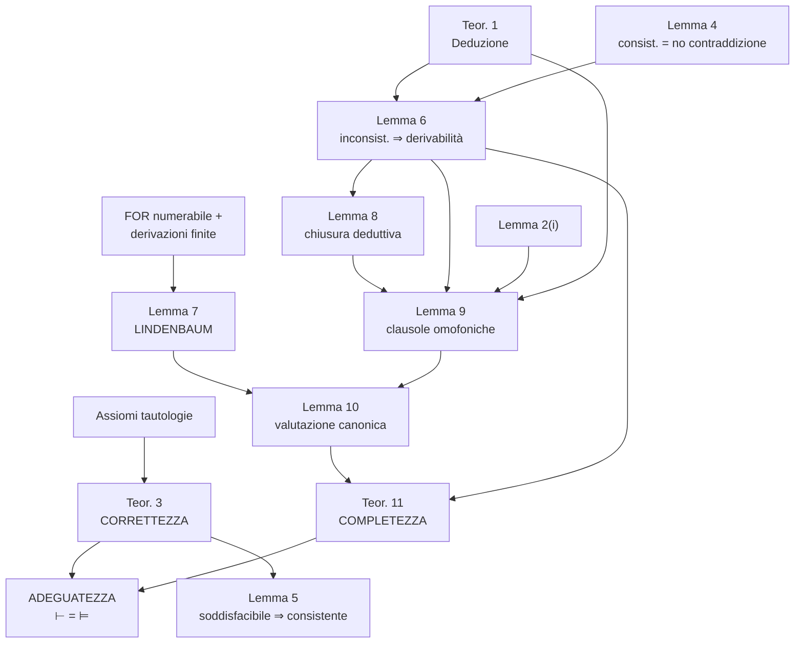

# Mappa della dimostrazione e checklist di ripasso
← [[05 - Valutazione canonica e completezza]] | [[00 - Indice]]

## Dipendenze tra i risultati

## La strategia della completezza in 5 passi
1. $\Gamma\nvdash\alpha$ ⇒ $\Gamma\cup\{\neg\alpha\}$ consistente (**Lemma 6**).
2. Estendo a un consistente massimale $\Delta$ (**Lindenbaum**).
3. $\Delta$ è chiuso per derivabilità (**Lemma 8**) e rispetta le clausole dei connettivi (**Lemma 9**).
4. Definisco $v(p)=1$ sse $p\in\Delta$; per induzione $v(\varphi)=1$ sse $\varphi\in\Delta$ (**Lemma 10**).
5. $v$ rende vero $\Gamma$ e falsa $\alpha$ ⇒ $\Gamma\not\models\alpha$ (**Teorema 11**).

## Cosa saper enunciare e dimostrare
- [ ] Definizione di $\mathcal{L}_0$, $FOR(\mathcal{L}_0)$, assiomi A1–A11, R1
- [ ] Definizione di dimostrazione, teorema, derivazione
- [ ] Dimostrazioni di T1 ($\alpha\to\alpha$) e T2 (assorbimento)
- [ ] Teorema di deduzione (enunciato; la dimostrazione è un plus)
- [ ] Valutazione, conseguenza logica, tautologia
- [ ] Teorema 3 (correttezza) + verifica di qualche assioma
- [ ] Def. di consistenza e Lemma 4
- [ ] Lemmi 5 e 6 (entrambi i punti)
- [ ] Def. di consistente massimale e **Lemma di Lindenbaum**
- [ ] Lemma 8 (chiusura deduttiva)
- [ ] Lemma 9 (almeno casi 1, 2, 4)
- [ ] Lemma 10 (valutazione canonica)
- [ ] Teorema 11 e teorema di adeguatezza

## Modulo 2 — calcoli ND e PK
- [ ] Regole di ND, chiusura delle assunzioni, forma normale → [[14 - Deduzione naturale ND]]
- [ ] Regole di PK (principale, ausiliaria, contesto) e interpretazione delle sequenze → [[15 - Calcolo dei sequenti Pk]]
- [ ] Teorema 1 (eliminazione dell'identità) e Teorema 5 (equivalenza ND–PK) → [[16 - Dispensa Calcoli]]
- [ ] Esercizi aggiuntivi in ND e in PK → [[17 - Esercizi aggiuntivi ND e PK]]
- [ ] Domande ufficiali → [[18 - Possibili domande d'esame]]

## Domande tipiche (prova a rispondere)
> [!question]- Perché nella dimostrazione di correttezza serve verificare che gli assiomi sono tautologie?
> Perché nella base dell'induzione (e nel passo, se $\alpha$ è un assioma) la formula derivata può essere un assioma: bisogna sapere che è vero sotto ogni valutazione.

> [!question]- Dove si usa che le derivazioni sono finite?
> Nel Lemma di Lindenbaum, per mostrare che $\Delta=\bigcup\Gamma_n$ è consistente: una derivazione di una contraddizione da $\Delta$ userebbe solo finite assunzioni, già tutte contenute in qualche $\Gamma_k$.

> [!question]- Dove si usa la numerabilità di $FOR(\mathcal{L}_0)$?
> Nel Lemma di Lindenbaum, per enumerare le formule $\alpha_1,\alpha_2,\dots$ e costruire la catena $\Gamma_n$.

> [!question]- Perché non basta che $\Gamma$ sia consistente, ma serve estenderlo a un massimale?
> Un insieme consistente qualsiasi può non "decidere" una formula (né $\varphi$ né $\neg\varphi$ vi appartengono), quindi non determina una valutazione. Un massimale decide ogni formula (Lemma 9.1) e rispetta le clausole dei connettivi (Lemma 9).

> [!question]- Quale assioma usa il Lemma 6 (i) e non il (ii)? Perché?
> A11 ($\neg\neg\alpha\to\alpha$): da A9 si ottiene $\neg\neg\alpha$ e serve la doppia negazione per arrivare ad $\alpha$. In (ii) si ottiene direttamente $\neg\alpha$.

> [!question]- Che legame c'è tra Lemma 5 e Lemma 10?
> Sono conversi: insieme dicono che un insieme è **consistente sse è soddisfacibile**. Il Lemma 5 usa la correttezza, il Lemma 10 è il cuore della completezza.
