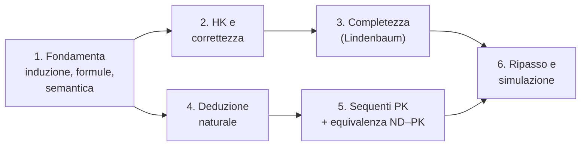

# Roadmap di studio — moduli 2 e 3
← [[00 - Indice]]

> [!abstract] L'idea in breve
> 16 **sessioni** da circa 2 ore, in 6 fasi. L'ordine segue le **dipendenze** tra gli argomenti: prima la semantica, poi i calcoli, poi i teoremi che li collegano.
> Ogni sessione mescola **teoria** (capire e ricostruire le dimostrazioni) ed **esercizi**: all'esame contano entrambi, e conta soprattutto saper **spiegare il processo**.

## Perché quest'ordine

- **L'induzione serve ovunque**: correttezza (lunghezza della derivazione), valutazione canonica (numero di connettivi), Teorema 1 ed equivalenza ND–PK (numero di vertici).
- **La semantica viene prima dei calcoli**: correttezza e completezza confrontano $\vdash$ con $\models$.
- **La completezza è la parte più lunga**: va divisa su 3 sessioni e ripassata più volte.
- **L'equivalenza ND–PK richiede di conoscere bene entrambi i calcoli**, quindi arriva dopo.

---

## Come è fatta una sessione (circa 2 ore)

| Tempo | Attività |
|---|---|
| 15 min | **Richiamo a memoria** della sessione precedente: enunciati e idea delle dimostrazioni, senza guardare |
| 60 min | **Studio nuovo**: leggi la nota, poi chiudila e **riscrivi** ogni dimostrazione su carta |
| 30 min | **Esercizi** (prima da solo, poi apri la soluzione richiudibile) |
| 15 min | **Spiegazione a voce** di un argomento, come all'orale; spunta le caselle |

> [!tip] Regole d'oro
> - Una dimostrazione è "fatta" solo quando la **riscrivi da zero** senza guardare.
> - Per ogni teorema impara prima la **strategia in una frase**, poi i dettagli.
> - Nelle derivazioni ND/PK **spiega ad alta voce** perché scegli ogni regola: è quello che viene valutato.
> - Quando sbagli, annota nella nota con un callout `> [!bug]`: sono i punti da ripassare.

---

## Fase 1 — Fondamenta (sessioni 1–3)

### Sessione 1 · Induzione e linguaggio
- [ ] [[10 - Nozioni preliminari e induzione]]: principio d'induzione **con dimostrazione**, induzione completa, definizioni induttive
- [ ] [[11 - Il linguaggio della logica proposizionale]]: Def. 6.82, convenzione sulle parentesi, sottoformule
- [ ] Esercizi: 6.83, 6.93
- 🎯 Saper dire: *"Perché il principio d'induzione è valido?"*

### Sessione 2 · Semantica
- [ ] [[12 - Tavole di verità, valutazioni e conseguenza logica]]: tavole, procedura, Def. 7.97, interpretazione vs valutazione
- [ ] Esercizi: 7.95, 7.96, 7.98, tavola di $\neg A\to(B\lor\neg A)$ ([[18 - Possibili domande d'esame|domanda d'esame]])

### Sessione 3 · Conseguenza logica e definibilità
- [ ] Conseguenza ed equivalenza logica (Def. 7.106–7.108), bicondizionale
- [ ] Esercizi: 7.101, 7.102, 7.105, 7.111, **7.112** (definibilità), Esempio 8.116
- [ ] [[02 - Semantica e conseguenza logica]]: collega la notazione del libro a quella della dispensa
- 🎯 Saper fare: tavola di verità spiegando il procedimento; stabilire se un argomento è valido

---

## Fase 2 — Il calcolo HK e la correttezza (sessioni 4–5)

### Sessione 4 · Sintassi di HK
- [ ] [[01 - Il calcolo HK (sintassi)]]: assiomi A1–A11 (impara il "come ricordarli"), dimostrazione, derivazione
- [ ] **Riscrivi T1 e T2** indicando per ogni passo l'istanza di sostituzione
- [ ] Teorema di deduzione (enunciato + idea), Lemma 2(i)
- [ ] [[13 - Il calcolo à la Hilbert H (libro)]]: solo il confronto H/HK
- 🎯 Domanda d'esame: *"Mi spieghi ogni passaggio di questa dimostrazione in HK"*

### Sessione 5 · Correttezza
- [ ] [[03 - Teorema di correttezza]]: dimostrazione per induzione sulla lunghezza
- [ ] Verifica a mano che **3–4 assiomi** sono tautologie (A2, A8, A9, A11)
- [ ] Ripasso a voce di T1 e T2

---

## Fase 3 — La completezza (sessioni 6–8) ⭐ la parte più impegnativa

> [!warning] Prima di iniziare
> Leggi la **strategia in 5 passi** in [[06 - Mappa della dimostrazione e checklist]] e tienila davanti per tutta la fase: ogni lemma è un pezzo di quel piano.

### Sessione 6 · Consistenza
- [ ] [[04 - Consistenza e insiemi consistenti massimali]]: definizione, **Lemma 4**, **Lemma 5**, **Lemma 6** (i) e (ii)
- [ ] Nota quali assiomi usa ogni lemma (A9, A10, A11)

### Sessione 7 · Lindenbaum e insiemi massimali
- [ ] Insieme consistente massimale, **Lemma 7 (Lindenbaum)**: costruzione, consistenza, massimalità
- [ ] **Lemma 8** (chiusura deduttiva), **Lemma 9** (casi 1, 2, 4; poi il 3)
- 🎯 Saper dire dove servono la **numerabilità** delle formule e la **finitezza** delle derivazioni

### Sessione 8 · Valutazione canonica e completezza
- [ ] [[05 - Valutazione canonica e completezza]]: **Lemma 10** (tutti i casi), **Teorema 11**, adeguatezza
- [ ] Ricostruisci **l'intera catena** dal Lemma 4 al Teorema 11 su un foglio, senza guardare
- [ ] Rispondi alle domande della [[06 - Mappa della dimostrazione e checklist|checklist]]

---

## Fase 4 — Deduzione naturale (sessioni 9–10)

### Sessione 9 · Regole di ND
- [ ] [[14 - Deduzione naturale ND]]: tutte le regole e la loro lettura intuitiva; assunzioni aperte e chiuse; chiusura vacua e multipla
- [ ] Rifai gli esempi 11.185, Ax2, DN(b), terzo escluso
- [ ] Esercizio d'esame: $A\to(B\to C)$ da $B\to(A\to C)$
- [ ] [[17 - Esercizi aggiuntivi ND e PK]]: esercizi **1–4 in ND**

### Sessione 10 · Pratica e forma normale
- [ ] Esercizi aggiuntivi **5–11 in ND** (attenzione al $\lor E$ in 7, 9, 10, 11)
- [ ] Es. 11.193 (3), (5), (7)
- [ ] Formula massimale, forma normale, Teorema 11.196
- 🎯 Domanda d'esame: *"Cos'è una derivazione in forma normale?"* (con esempio normale e non normale)

---

## Fase 5 — Sequenti ed equivalenza ND–PK (sessioni 11–13)

### Sessione 11 · Regole di PK
- [ ] [[15 - Calcolo dei sequenti Pk]]: interpretazione delle sequenze (la virgola!), regole strutturali e operazionali, principale/ausiliaria/contesto
- [ ] Rifai gli esempi di 3.12.1, soprattutto **De Morgan 2** (domanda d'esame)
- 🎯 Domande d'esame: *"Quali sono le regole di PK?"*, *"Come si interpreta una sequenza?"*

### Sessione 12 · Pratica su PK
- [ ] Esercizi aggiuntivi **1–11 in PK** (impara prima il Lemma MP)
- [ ] Qualche item dell'Es. 12.201
- [ ] Confronta ogni esercizio con la sua versione ND: cosa corrisponde a cosa?

### Sessione 13 · Dispensa "Calcoli"
- [ ] [[16 - Dispensa Calcoli]]: **Teorema 1** (eliminazione dell'identità)
- [ ] Def. 2–4 con esempi; **Teorema 5** parte (1) e parte (2), casi della dispensa
- [ ] Prova ad esporlo seguendo "Come esporlo all'orale"
- 🎯 Domanda d'esame: *"Dimostri l'equivalenza tra ND e PK"*

---

## Fase 6 — Ripasso e simulazione (sessioni 14–16)

### Sessione 14 · Ripasso dei teoremi
- [ ] Riscrivi a memoria: induzione, correttezza, Lindenbaum, Lemma 10, Teorema 11, Teorema 1, Teorema 5
- [ ] Segna in rosso quello che non ricordi e ripassalo subito

### Sessione 15 · Esercizi misti
- [ ] Esercizi aggiuntivi presi **in ordine casuale**, alternando ND e PK
- [ ] Una tavola di verità, una verifica di validità, una "spiegazione" di T1 o T2

### Sessione 16 · Simulazione d'esame
- [ ] Prendi 5–6 domande da [[18 - Possibili domande d'esame]] e **rispondi a voce**, cronometrandoti (circa 5 minuti ciascuna)
- [ ] Fai 1 derivazione ND e 1 PK nuove, spiegando ogni passo
- [ ] Rivedi solo i punti segnati con `> [!bug]`

---

## Calendario in base al tempo disponibile

| Tempo fino all'esame | Ritmo | Come distribuire |
|---|---|---|
| **2 settimane** | 1 sessione al giorno, 2 giorni liberi | Fase 1–2 nella 1ª settimana con la sessione 6; fasi 3 (resto)–6 nella 2ª |
| **3 settimane** | 5–6 sessioni a settimana | Sett. 1: fasi 1–2 · Sett. 2: fasi 3–4 · Sett. 3: fasi 5–6 |
| **4+ settimane** | 4 sessioni a settimana | Una fase a settimana circa, più un ripasso settimanale di 1 ora sulla fase precedente |
| **Meno di 10 giorni** | Sessioni doppie | Priorità: completezza (fase 3), domande d'esame ufficiali, esercizi ND/PK. Riduci fasi 1 e 4 a una sessione ciascuna |

> [!tip] Ripetizione distanziata
> Gli enunciati dei teoremi principali vanno ripassati **1, 3 e 7 giorni** dopo averli studiati: bastano 10 minuti a voce all'inizio della sessione.

## Priorità, se il tempo è poco
1. 🔴 **Completezza di HK** (catena completa) e **correttezza**
2. 🔴 **Domande ufficiali** ([[18 - Possibili domande d'esame]]), soprattutto l'equivalenza ND–PK e le due derivazioni
3. 🟠 **Esercizi aggiuntivi** in ND e PK
4. 🟠 Regole di ND e PK, forma normale, interpretazione delle sequenze
5. 🟡 Semantica, tavole di verità, definibilità
6. 🟡 Induzione, linguaggio, confronto H/HK
